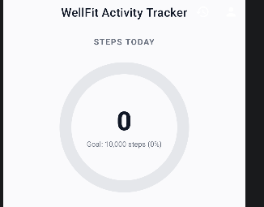
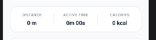
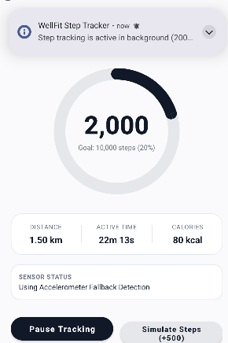
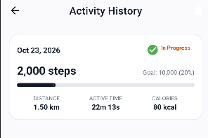
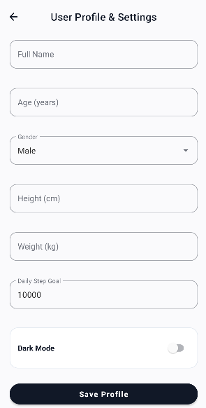

# WellFit - Android Activity Tracker Application Report

---

## 1. Introduction and Objective

**WellFit** is a native Android fitness and health-tracking application designed to empower users to monitor, track, and analyze their daily physical activity in real time. The primary objective of the application is to provide an intuitive, modern, and non-intrusive step-tracking experience that operates seamlessly both in the foreground and in the background as a persistent service.

### Key Objectives
* **Real-time Step Detection**: Accurately detect physical steps using hardware sensors (`TYPE_STEP_COUNTER` and `TYPE_STEP_DETECTOR`) or an accelerometer-based peak detection algorithm as a fallback.
* **Health Metrics Computation**: Dynamically compute stride-based distance (in meters/kilometers), active duration (in minutes/seconds), and caloric expenditure (in kcal) tailored to personalized body metrics (height and weight).
* **Background & Foreground Service Continuity**: Maintain uninterrupted step counting across app lifecycle state changes (backgrounding, screen lock, system restarts) using an Android Foreground Service and system notifications.
* **Persistent Storage & History Logging**: Automatically log daily activity summaries into a local SQLite database (`wellfit.db`) and user settings into `SharedPreferences` (`wellfit_prefs`).
* **Minimalist & Modern UI Design**: Deliver a sleek, professional monochrome user interface featuring a prominent circular ring dial gauge, pill buttons, dark mode support, and historical trend visualization.

---

## 2. Application Design

The architecture of **WellFit** follows standard Android design principles, utilizing key system components, declarative layout structures, and Material Design 3 guidelines.

### 2.1 Android System Components

| Component | Class Name | Description |
| :--- | :--- | :--- |
| **Activity** | `MainActivity` | Main dashboard displaying the circular step gauge, live metric cards, sensor status, and action controls. |
| **Activity** | `ProfileActivity` | User settings screen allowing input of personal physical attributes (height, weight, age, step goal) and theme toggles. |
| **Activity** | `HistoryActivity` | Displays historical activity logs stored in the local SQLite database via a `RecyclerView`. |
| **Foreground Service** | `StepTrackingService` | Runs independently in the background, listening to motion sensors and updating persistent notifications. |
| **BroadcastReceiver** | `stepReceiver` | Registered dynamically in `MainActivity` to receive real-time step update intents from `StepTrackingService`. |
| **SQLite OpenHelper** | `DatabaseHelper` | Manages local SQLite storage for daily activity records (`activity_logs` table). |
| **SharedPreferences** | `PreferenceManager` | Handles key-value storage for user profile metrics, daily step targets, and dark mode toggles. |
| **SensorEventListener** | `StepSensorManager` | Handles hardware sensor event listeners and manages fallbacks between hardware step counters and raw accelerometer signal processing. |

### 2.2 User Interface Design Strategy
* **Modern Monochrome Aesthetic**: Designed with a clean, high-contrast monochrome color palette (`#111827` primary black, `#FAFAFC` light background, `#1F2937` dark mode surface).
* **Hero Circular Dial Gauge**: Utilizes Material Design's `CircularProgressIndicator` wrapped in a centered layout with large bold step counts (`44sp`).
* **Capsule Pill Buttons**: Primary actions use full-radius pill buttons (`app:cornerRadius="26dp"`) for modern touch targets.
* **Data Cards**: Metric display containers feature soft rounded corners (`16dp` to `20dp`) with thin border strokes (`1dp`) for clear visual hierarchy.

---

## 3. Complete Source Code

### 3.1 Java Source Files

#### 1. `MainActivity.java`
```java
package com.example.smartfit;

import android.Manifest;
import android.content.BroadcastReceiver;
import android.content.ComponentName;
import android.content.Context;
import android.content.Intent;
import android.content.IntentFilter;
import android.content.ServiceConnection;
import android.content.pm.PackageManager;
import android.os.Build;
import android.os.Bundle;
import android.os.IBinder;
import android.view.Menu;
import android.view.MenuItem;
import android.widget.TextView;
import android.widget.Toast;

import androidx.annotation.NonNull;
import androidx.appcompat.app.AppCompatActivity;
import androidx.appcompat.app.AppCompatDelegate;
import androidx.core.app.ActivityCompat;
import androidx.core.content.ContextCompat;

import com.google.android.material.appbar.MaterialToolbar;
import com.google.android.material.button.MaterialButton;
import com.google.android.material.progressindicator.CircularProgressIndicator;

import java.text.NumberFormat;
import java.text.SimpleDateFormat;
import java.util.ArrayList;
import java.util.Date;
import java.util.List;
import java.util.Locale;

public class MainActivity extends AppCompatActivity {

    private static final int PERMISSION_REQUEST_CODE = 101;

    private PreferenceManager preferenceManager;
    private DatabaseHelper databaseHelper;

    private TextView tvStepCount;
    private TextView tvStepGoal;
    private CircularProgressIndicator progressSteps;
    private TextView tvDistance;
    private TextView tvDuration;
    private TextView tvCalories;
    private TextView tvSensorStatus;
    private MaterialButton btnOpenHistory;
    private MaterialButton btnToggleTracking;
    private MaterialButton btnSimulateSteps;
    private MaterialButton btnOpenProfile;
    private MaterialToolbar toolbarMain;

    private StepTrackingService stepTrackingService;
    private boolean isBound = false;
    private boolean isTrackingPaused = false;

    private final ServiceConnection serviceConnection = new ServiceConnection() {
        @Override
        public void onServiceConnected(ComponentName name, IBinder service) {
            StepTrackingService.StepBinder binder = (StepTrackingService.StepBinder) service;
            stepTrackingService = binder.getService();
            isBound = true;
            refreshUiFromStorage();
        }

        @Override
        public void onServiceDisconnected(ComponentName name) {
            stepTrackingService = null;
            isBound = false;
        }
    };

    private final BroadcastReceiver stepReceiver = new BroadcastReceiver() {
        @Override
        public void onReceive(Context context, Intent intent) {
            if (intent != null && StepTrackingService.ACTION_STEP_UPDATE.equals(intent.getAction())) {
                int steps = intent.getIntExtra(StepTrackingService.EXTRA_STEPS, 0);
                float distance = intent.getFloatExtra(StepTrackingService.EXTRA_DISTANCE, 0.0f);
                int duration = intent.getIntExtra(StepTrackingService.EXTRA_DURATION, 0);
                int calories = intent.getIntExtra(StepTrackingService.EXTRA_CALORIES, 0);
                int goal = intent.getIntExtra(StepTrackingService.EXTRA_GOAL, 10000);
                String status = intent.getStringExtra(StepTrackingService.EXTRA_SENSOR_STATUS);

                updateUi(steps, distance, duration, calories, goal, status);
            }
        }
    };

    @Override
    protected void onCreate(Bundle savedInstanceState) {
        preferenceManager = new PreferenceManager(this);
        databaseHelper = new DatabaseHelper(this);

        if (preferenceManager.isDarkModeEnabled()) {
            AppCompatDelegate.setDefaultNightMode(AppCompatDelegate.MODE_NIGHT_YES);
        } else {
            AppCompatDelegate.setDefaultNightMode(AppCompatDelegate.MODE_NIGHT_NO);
        }

        super.onCreate(savedInstanceState);
        setContentView(R.layout.activity_main);

        initViews();
        setupToolbar();
        checkAndRequestPermissions();
        setupListeners();
    }

    private void initViews() {
        toolbarMain = findViewById(R.id.toolbarMain);
        tvStepCount = findViewById(R.id.tvStepCount);
        tvStepGoal = findViewById(R.id.tvStepGoal);
        progressSteps = findViewById(R.id.progressSteps);
        tvDistance = findViewById(R.id.tvDistance);
        tvDuration = findViewById(R.id.tvDuration);
        tvCalories = findViewById(R.id.tvCalories);
        tvSensorStatus = findViewById(R.id.tvSensorStatus);
        btnOpenHistory = findViewById(R.id.btnOpenHistory);
        btnToggleTracking = findViewById(R.id.btnToggleTracking);
        btnSimulateSteps = findViewById(R.id.btnSimulateSteps);
        btnOpenProfile = findViewById(R.id.btnOpenProfile);
    }

    private void setupToolbar() {
        if (toolbarMain != null) {
            setSupportActionBar(toolbarMain);
        }
    }

    @Override
    public boolean onCreateOptionsMenu(Menu menu) {
        getMenuInflater().inflate(R.menu.menu_main, menu);
        return true;
    }

    @Override
    public boolean onOptionsItemSelected(@NonNull MenuItem item) {
        int id = item.getItemId();
        if (id == R.id.action_history) {
            startActivity(new Intent(this, HistoryActivity.class));
            return true;
        } else if (id == R.id.action_profile) {
            startActivity(new Intent(this, ProfileActivity.class));
            return true;
        }
        return super.onOptionsItemSelected(item);
    }

    private void setupListeners() {
        btnOpenHistory.setOnClickListener(v -> {
            Intent intent = new Intent(MainActivity.this, HistoryActivity.class);
            startActivity(intent);
        });

        btnOpenProfile.setOnClickListener(v -> {
            Intent intent = new Intent(MainActivity.this, ProfileActivity.class);
            startActivity(intent);
        });

        btnSimulateSteps.setOnClickListener(v -> {
            if (stepTrackingService != null) {
                stepTrackingService.addManualStepsForTesting(500);
                Toast.makeText(this, "Simulated +500 steps", Toast.LENGTH_SHORT).show();
            } else {
                Toast.makeText(this, "Step service is initializing...", Toast.LENGTH_SHORT).show();
            }
        });

        btnToggleTracking.setOnClickListener(v -> {
            if (isTrackingPaused) {
                isTrackingPaused = false;
                btnToggleTracking.setText(R.string.btn_pause_tracking);
                startAndBindStepService();
                Toast.makeText(this, "Step tracking resumed", Toast.LENGTH_SHORT).show();
            } else {
                isTrackingPaused = true;
                btnToggleTracking.setText(R.string.btn_resume_tracking);
                stopAndUnbindStepService();
                tvSensorStatus.setText(R.string.status_tracking_paused);
                Toast.makeText(this, "Step tracking paused", Toast.LENGTH_SHORT).show();
            }
        });
    }

    private void checkAndRequestPermissions() {
        List<String> permissionsToRequest = new ArrayList<>();

        if (Build.VERSION.SDK_INT >= Build.VERSION_CODES.Q) {
            if (ContextCompat.checkSelfPermission(this, Manifest.permission.ACTIVITY_RECOGNITION)
                    != PackageManager.PERMISSION_GRANTED) {
                permissionsToRequest.add(Manifest.permission.ACTIVITY_RECOGNITION);
            }
        }

        if (Build.VERSION.SDK_INT >= Build.VERSION_CODES.TIRAMISU) {
            if (ContextCompat.checkSelfPermission(this, Manifest.permission.POST_NOTIFICATIONS)
                    != PackageManager.PERMISSION_GRANTED) {
                permissionsToRequest.add(Manifest.permission.POST_NOTIFICATIONS);
            }
        }

        if (!permissionsToRequest.isEmpty()) {
            ActivityCompat.requestPermissions(
                    this,
                    permissionsToRequest.toArray(new String[0]),
                    PERMISSION_REQUEST_CODE
            );
        }
    }

    @Override
    public void onRequestPermissionsResult(int requestCode, @NonNull String[] permissions, @NonNull int[] grantResults) {
        super.onRequestPermissionsResult(requestCode, permissions, grantResults);
        if (requestCode == PERMISSION_REQUEST_CODE) {
            startAndBindStepService();
        }
    }

    private void startAndBindStepService() {
        if (isTrackingPaused) {
            return;
        }
        Intent intent = new Intent(this, StepTrackingService.class);
        if (Build.VERSION.SDK_INT >= Build.VERSION_CODES.O) {
            startForegroundService(intent);
        } else {
            startService(intent);
        }
        if (!isBound) {
            bindService(intent, serviceConnection, Context.BIND_AUTO_CREATE);
        }
    }

    private void stopAndUnbindStepService() {
        if (isBound) {
            unbindService(serviceConnection);
            isBound = false;
        }
        Intent intent = new Intent(this, StepTrackingService.class);
        stopService(intent);
    }

    @Override
    protected void onResume() {
        super.onResume();
        registerStepReceiver();
        if (!isTrackingPaused) {
            startAndBindStepService();
        }
        refreshUiFromStorage();
    }

    @Override
    protected void onPause() {
        super.onPause();
        unregisterStepReceiver();
        if (isBound) {
            unbindService(serviceConnection);
            isBound = false;
        }
    }

    private void registerStepReceiver() {
        IntentFilter filter = new IntentFilter(StepTrackingService.ACTION_STEP_UPDATE);
        ContextCompat.registerReceiver(this, stepReceiver, filter, ContextCompat.RECEIVER_NOT_EXPORTED);
    }

    private void unregisterStepReceiver() {
        try {
            unregisterReceiver(stepReceiver);
        } catch (IllegalArgumentException ignored) {
            // Unregistered
        }
    }

    private void refreshUiFromStorage() {
        String today = new SimpleDateFormat("yyyy-MM-dd", Locale.getDefault()).format(new Date());
        ActivityLog log = databaseHelper.getLogForDate(today);

        int steps;
        float distance;
        int duration;
        int calories;
        int goal = preferenceManager.getStepGoal();

        if (log != null) {
            steps = log.getSteps();
            distance = log.getDistanceMeters();
            duration = log.getDurationSeconds();
            calories = log.getCalories();
        } else {
            steps = preferenceManager.getCurrentDaySteps();
            float heightCm = preferenceManager.getHeightCm();
            float weightKg = preferenceManager.getWeightKg();
            distance = StepCalculator.calculateDistanceMeters(steps, heightCm);
            duration = StepCalculator.calculateActiveDurationSeconds(steps);
            calories = StepCalculator.calculateCalories(steps, weightKg);
        }

        String sensorStatus = (stepTrackingService != null) ?
                stepTrackingService.getCurrentSensorStatus() : "Monitoring motion sensors";

        updateUi(steps, distance, duration, calories, goal, sensorStatus);
    }

    private void updateUi(int steps, float distanceMeters, int durationSeconds, int calories, int goal, String sensorStatus) {
        String formattedSteps = NumberFormat.getNumberInstance(Locale.getDefault()).format(steps);
        tvStepCount.setText(formattedSteps);

        int percent = (goal > 0) ? (int) Math.min(100, ((float) steps / goal) * 100) : 0;
        String goalText = String.format(Locale.getDefault(), "Goal: %s steps (%d%%)",
                NumberFormat.getNumberInstance(Locale.getDefault()).format(goal), percent);
        tvStepGoal.setText(goalText);

        progressSteps.setProgress(percent);

        if (distanceMeters >= 1000) {
            tvDistance.setText(String.format(Locale.getDefault(), "%.2f km", distanceMeters / 1000.0f));
        } else {
            tvDistance.setText(String.format(Locale.getDefault(), "%.0f m", distanceMeters));
        }

        tvDuration.setText(StepCalculator.formatDuration(durationSeconds));
        tvCalories.setText(String.format(Locale.getDefault(), "%d kcal", calories));

        if (sensorStatus != null && !sensorStatus.isEmpty()) {
            tvSensorStatus.setText(sensorStatus);
        }
    }
}
```

#### 2. `StepTrackingService.java`
```java
package com.example.smartfit;

import android.app.Notification;
import android.app.PendingIntent;
import android.app.Service;
import android.content.Intent;
import android.content.pm.ServiceInfo;
import android.os.Binder;
import android.os.Build;
import android.os.IBinder;

import androidx.annotation.Nullable;
import androidx.core.app.NotificationCompat;

import java.text.SimpleDateFormat;
import java.util.Date;
import java.util.Locale;

public class StepTrackingService extends Service implements StepSensorManager.StepSensorListener {

    public static final String ACTION_STEP_UPDATE = "com.example.smartfit.ACTION_STEP_UPDATE";
    public static final String EXTRA_STEPS = "extra_steps";
    public static final String EXTRA_DISTANCE = "extra_distance";
    public static final String EXTRA_DURATION = "extra_duration";
    public static final String EXTRA_CALORIES = "extra_calories";
    public static final String EXTRA_GOAL = "extra_goal";
    public static final String EXTRA_SENSOR_STATUS = "extra_sensor_status";

    private final IBinder binder = new StepBinder();
    private StepSensorManager stepSensorManager;
    private DatabaseHelper databaseHelper;
    private PreferenceManager preferenceManager;

    private int currentSteps = 0;
    private String todayDate;
    private String currentSensorStatus = "Initializing sensors...";

    public class StepBinder extends Binder {
        public StepTrackingService getService() {
            return StepTrackingService.this;
        }
    }

    @Override
    public void onCreate() {
        super.onCreate();
        databaseHelper = new DatabaseHelper(this);
        preferenceManager = new PreferenceManager(this);
        stepSensorManager = new StepSensorManager(this);
        stepSensorManager.setListener(this);

        updateTodayDate();
        loadTodaySteps();
        startForegroundServiceNotification();
        stepSensorManager.startListening();
    }

    @Override
    public int onStartCommand(Intent intent, int flags, int startId) {
        startForegroundServiceNotification();
        if (!stepSensorManager.isListening()) {
            stepSensorManager.startListening();
        }
        return START_STICKY;
    }

    @Nullable
    @Override
    public IBinder onBind(Intent intent) {
        return binder;
    }

    @Override
    public void onDestroy() {
        if (stepSensorManager != null) {
            stepSensorManager.stopListening();
        }
        saveCurrentStateToDatabase();
        super.onDestroy();
    }

    private void updateTodayDate() {
        todayDate = new SimpleDateFormat("yyyy-MM-dd", Locale.getDefault()).format(new Date());
    }

    private void loadTodaySteps() {
        updateTodayDate();
        ActivityLog log = databaseHelper.getLogForDate(todayDate);
        if (log != null) {
            currentSteps = log.getSteps();
        } else {
            currentSteps = preferenceManager.getCurrentDaySteps();
        }
    }

    private void startForegroundServiceNotification() {
        NotificationHelper.createNotificationChannel(this);

        Intent notificationIntent = new Intent(this, MainActivity.class);
        PendingIntent pendingIntent = PendingIntent.getActivity(
                this,
                0,
                notificationIntent,
                PendingIntent.FLAG_UPDATE_CURRENT | PendingIntent.FLAG_IMMUTABLE
        );

        Notification notification = new NotificationCompat.Builder(this, NotificationHelper.CHANNEL_ID)
                .setContentTitle("WellFit Step Tracker")
                .setContentText("Step tracking is active in background (" + currentSteps + " steps)")
                .setSmallIcon(android.R.drawable.ic_dialog_info)
                .setContentIntent(pendingIntent)
                .setOngoing(true)
                .setPriority(NotificationCompat.PRIORITY_LOW)
                .build();

        if (Build.VERSION.SDK_INT >= Build.VERSION_CODES.Q) {
            if (Build.VERSION.SDK_INT >= Build.VERSION_CODES.UPSIDE_DOWN_CAKE) {
                startForeground(NotificationHelper.FOREGROUND_SERVICE_NOTIFICATION_ID, notification, ServiceInfo.FOREGROUND_SERVICE_TYPE_HEALTH);
            } else {
                startForeground(NotificationHelper.FOREGROUND_SERVICE_NOTIFICATION_ID, notification);
            }
        } else {
            startForeground(NotificationHelper.FOREGROUND_SERVICE_NOTIFICATION_ID, notification);
        }
    }

    @Override
    public void onStep(int stepIncrement, StepSensorManager.SensorMode mode) {
        updateTodayDate();
        currentSteps += stepIncrement;
        preferenceManager.setCurrentDaySteps(currentSteps);

        saveCurrentStateToDatabase();
        checkGoalAndNotify();
        broadcastStepUpdate();
    }

    @Override
    public void onSensorStatusChanged(StepSensorManager.SensorMode mode, String statusMessage) {
        this.currentSensorStatus = statusMessage;
        broadcastStepUpdate();
    }

    private void saveCurrentStateToDatabase() {
        updateTodayDate();
        float heightCm = preferenceManager.getHeightCm();
        float weightKg = preferenceManager.getWeightKg();
        int goal = preferenceManager.getStepGoal();

        float distanceMeters = StepCalculator.calculateDistanceMeters(currentSteps, heightCm);
        int durationSeconds = StepCalculator.calculateActiveDurationSeconds(currentSteps);
        int calories = StepCalculator.calculateCalories(currentSteps, weightKg);

        databaseHelper.saveOrUpdateDailyLog(todayDate, currentSteps, durationSeconds, distanceMeters, calories, goal);
    }

    private void checkGoalAndNotify() {
        int goal = preferenceManager.getStepGoal();
        NotificationHelper.checkAndNotifyGoalReached(this, currentSteps, goal);
    }

    private void broadcastStepUpdate() {
        float heightCm = preferenceManager.getHeightCm();
        float weightKg = preferenceManager.getWeightKg();
        int goal = preferenceManager.getStepGoal();

        float distanceMeters = StepCalculator.calculateDistanceMeters(currentSteps, heightCm);
        int durationSeconds = StepCalculator.calculateActiveDurationSeconds(currentSteps);
        int calories = StepCalculator.calculateCalories(currentSteps, weightKg);

        Intent intent = new Intent(ACTION_STEP_UPDATE);
        intent.putExtra(EXTRA_STEPS, currentSteps);
        intent.putExtra(EXTRA_DISTANCE, distanceMeters);
        intent.putExtra(EXTRA_DURATION, durationSeconds);
        intent.putExtra(EXTRA_CALORIES, calories);
        intent.putExtra(EXTRA_GOAL, goal);
        intent.putExtra(EXTRA_SENSOR_STATUS, currentSensorStatus);
        sendBroadcast(intent);
    }

    public int getCurrentSteps() {
        return currentSteps;
    }

    public String getCurrentSensorStatus() {
        return currentSensorStatus;
    }

    public void addManualStepsForTesting(int steps) {
        onStep(steps, stepSensorManager != null ? stepSensorManager.getCurrentMode() : StepSensorManager.SensorMode.ACCELEROMETER_FALLBACK);
    }
}
```

#### 3. `StepSensorManager.java`
```java
package com.example.smartfit;

import android.content.Context;
import android.hardware.Sensor;
import android.hardware.SensorEvent;
import android.hardware.SensorEventListener;
import android.hardware.SensorManager;

public class StepSensorManager implements SensorEventListener {

    public enum SensorMode {
        HARDWARE_STEP_COUNTER,
        HARDWARE_STEP_DETECTOR,
        ACCELEROMETER_FALLBACK,
        UNAVAILABLE
    }

    public interface StepSensorListener {
        void onStep(int stepIncrement, SensorMode mode);
        void onSensorStatusChanged(SensorMode mode, String statusMessage);
    }

    private final SensorManager sensorManager;
    private final StepDetector stepDetector;

    private Sensor stepCounterSensor;
    private Sensor stepDetectorSensor;
    private Sensor accelerometerSensor;

    private SensorMode currentMode = SensorMode.UNAVAILABLE;
    private StepSensorListener listener;

    private boolean isListening = false;
    private float initialStepCounterValue = -1.0f;

    public StepSensorManager(Context context) {
        sensorManager = (SensorManager) context.getSystemService(Context.SENSOR_SERVICE);
        stepDetector = new StepDetector();
        stepDetector.setStepListener(timestampNs -> {
            if (listener != null && currentMode == SensorMode.ACCELEROMETER_FALLBACK) {
                listener.onStep(1, currentMode);
            }
        });
        detectSensors();
    }

    private void detectSensors() {
        if (sensorManager != null) {
            stepCounterSensor = sensorManager.getDefaultSensor(Sensor.TYPE_STEP_COUNTER);
            stepDetectorSensor = sensorManager.getDefaultSensor(Sensor.TYPE_STEP_DETECTOR);
            accelerometerSensor = sensorManager.getDefaultSensor(Sensor.TYPE_ACCELEROMETER);
        }

        if (stepCounterSensor != null) {
            currentMode = SensorMode.HARDWARE_STEP_COUNTER;
        } else if (stepDetectorSensor != null) {
            currentMode = SensorMode.HARDWARE_STEP_DETECTOR;
        } else if (accelerometerSensor != null) {
            currentMode = SensorMode.ACCELEROMETER_FALLBACK;
        } else {
            currentMode = SensorMode.UNAVAILABLE;
        }
    }

    public void setListener(StepSensorListener listener) {
        this.listener = listener;
        if (listener != null) {
            listener.onSensorStatusChanged(currentMode, getStatusMessage());
        }
    }

    public SensorMode getCurrentMode() {
        return currentMode;
    }

    public boolean isSensorAvailable() {
        return currentMode != SensorMode.UNAVAILABLE;
    }

    public String getStatusMessage() {
        switch (currentMode) {
            case HARDWARE_STEP_COUNTER:
                return "Using Hardware Step Counter";
            case HARDWARE_STEP_DETECTOR:
                return "Using Hardware Step Detector";
            case ACCELEROMETER_FALLBACK:
                return "Using Accelerometer Fallback Detection";
            case UNAVAILABLE:
            default:
                return "No step sensors or accelerometer available on this device";
        }
    }

    public synchronized void startListening() {
        if (isListening || sensorManager == null) {
            return;
        }

        boolean registered = false;
        initialStepCounterValue = -1.0f;

        if (stepCounterSensor != null) {
            registered = sensorManager.registerListener(this, stepCounterSensor, SensorManager.SENSOR_DELAY_UI);
            if (registered) {
                currentMode = SensorMode.HARDWARE_STEP_COUNTER;
            }
        }

        if (!registered && stepDetectorSensor != null) {
            registered = sensorManager.registerListener(this, stepDetectorSensor, SensorManager.SENSOR_DELAY_UI);
            if (registered) {
                currentMode = SensorMode.HARDWARE_STEP_DETECTOR;
            }
        }

        if (!registered && accelerometerSensor != null) {
            registered = sensorManager.registerListener(this, accelerometerSensor, SensorManager.SENSOR_DELAY_GAME);
            if (registered) {
                currentMode = SensorMode.ACCELEROMETER_FALLBACK;
                stepDetector.reset();
            }
        }

        if (!registered) {
            currentMode = SensorMode.UNAVAILABLE;
        }

        isListening = registered;

        if (listener != null) {
            listener.onSensorStatusChanged(currentMode, getStatusMessage());
        }
    }

    public synchronized void stopListening() {
        if (!isListening || sensorManager == null) {
            return;
        }
        sensorManager.unregisterListener(this);
        isListening = false;
    }

    public boolean isListening() {
        return isListening;
    }

    @Override
    public void onSensorChanged(SensorEvent event) {
        if (event == null || event.sensor == null) {
            return;
        }

        int type = event.sensor.getType();

        if (type == Sensor.TYPE_STEP_COUNTER) {
            float totalStepsSoFar = event.values[0];
            if (initialStepCounterValue < 0) {
                initialStepCounterValue = totalStepsSoFar;
            } else {
                int deltaSteps = (int) (totalStepsSoFar - initialStepCounterValue);
                if (deltaSteps > 0) {
                    initialStepCounterValue = totalStepsSoFar;
                    if (listener != null) {
                        listener.onStep(deltaSteps, SensorMode.HARDWARE_STEP_COUNTER);
                    }
                }
            }
        } else if (type == Sensor.TYPE_STEP_DETECTOR) {
            if (event.values[0] == 1.0f) {
                if (listener != null) {
                    listener.onStep(1, SensorMode.HARDWARE_STEP_DETECTOR);
                }
            }
        } else if (type == Sensor.TYPE_ACCELEROMETER) {
            stepDetector.processSensorEvent(event);
        }
    }

    @Override
    public void onAccuracyChanged(Sensor sensor, int accuracy) {
        // No-op
    }
}
```

#### 4. `StepDetector.java`
```java
package com.example.smartfit;

import android.hardware.SensorEvent;

public class StepDetector {

    public interface StepListener {
        void onStepDetected(long timestampNs);
    }

    public static final float DEFAULT_THRESHOLD = 11.8f;
    public static final long DEFAULT_MIN_STEP_INTERVAL_NS = 280_000_000L;
    public static final float ALPHA = 0.8f;

    private float threshold;
    private long minStepIntervalNs;
    private StepListener listener;

    private float smoothedMagnitude = 0.0f;
    private float prevMagnitude = 0.0f;
    private boolean isRising = false;
    private long lastStepTimestampNs = 0L;
    private int totalSteps = 0;

    public StepDetector() {
        this(DEFAULT_THRESHOLD, DEFAULT_MIN_STEP_INTERVAL_NS);
    }

    public StepDetector(float threshold, long minStepIntervalNs) {
        this.threshold = threshold;
        this.minStepIntervalNs = minStepIntervalNs;
    }

    public void setStepListener(StepListener listener) {
        this.listener = listener;
    }

    public void reset() {
        smoothedMagnitude = 0.0f;
        prevMagnitude = 0.0f;
        isRising = false;
        lastStepTimestampNs = 0L;
        totalSteps = 0;
    }

    public int getTotalSteps() {
        return totalSteps;
    }

    public void processSensorEvent(SensorEvent event) {
        if (event == null || event.values == null || event.values.length < 3) {
            return;
        }
        processSample(event.values[0], event.values[1], event.values[2], event.timestamp);
    }

    public boolean processSample(float x, float y, float z, long timestampNs) {
        float rawMagnitude = (float) Math.sqrt(x * x + y * y + z * z);

        if (smoothedMagnitude == 0.0f) {
            smoothedMagnitude = rawMagnitude;
        } else {
            smoothedMagnitude = ALPHA * smoothedMagnitude + (1.0f - ALPHA) * rawMagnitude;
        }

        boolean stepDetected = false;

        if (smoothedMagnitude > prevMagnitude) {
            isRising = true;
        } else if (smoothedMagnitude < prevMagnitude && isRising) {
            isRising = false;
            if (prevMagnitude >= threshold) {
                if (timestampNs - lastStepTimestampNs >= minStepIntervalNs) {
                    lastStepTimestampNs = timestampNs;
                    totalSteps++;
                    stepDetected = true;
                    if (listener != null) {
                        listener.onStepDetected(timestampNs);
                    }
                }
            }
        }

        prevMagnitude = smoothedMagnitude;
        return stepDetected;
    }
}
```

#### 5. `StepCalculator.java`
```java
package com.example.smartfit;

import java.util.Locale;

public class StepCalculator {

    public static final float DEFAULT_STRIDE_LENGTH_METERS = 0.75f;
    public static final float DEFAULT_CALORIES_PER_STEP = 0.04f;
    public static final float STEPS_PER_SECOND = 1.5f;

    public static float getStrideLengthMeters(float heightCm) {
        if (heightCm > 0) {
            return (heightCm * 0.415f) / 100.0f;
        }
        return DEFAULT_STRIDE_LENGTH_METERS;
    }

    public static float calculateDistanceMeters(int stepCount, float heightCm) {
        if (stepCount <= 0) {
            return 0.0f;
        }
        float stride = getStrideLengthMeters(heightCm);
        return stepCount * stride;
    }

    public static float calculateDistanceKm(int stepCount, float heightCm) {
        return calculateDistanceMeters(stepCount, heightCm) / 1000.0f;
    }

    public static int calculateCalories(int stepCount, float weightKg) {
        if (stepCount <= 0) {
            return 0;
        }
        if (weightKg > 0) {
            return Math.round(stepCount * weightKg * 0.00057f);
        }
        return Math.round(stepCount * DEFAULT_CALORIES_PER_STEP);
    }

    public static int calculateActiveDurationSeconds(int stepCount) {
        if (stepCount <= 0) {
            return 0;
        }
        return Math.round(stepCount / STEPS_PER_SECOND);
    }

    public static String formatDuration(int durationSeconds) {
        int minutes = durationSeconds / 60;
        int seconds = durationSeconds % 60;
        if (minutes > 60) {
            int hours = minutes / 60;
            int remMinutes = minutes % 60;
            return String.format(Locale.getDefault(), "%dh %02dm", hours, remMinutes);
        }
        return String.format(Locale.getDefault(), "%dm %02ds", minutes, seconds);
    }
}
```

#### 6. `DatabaseHelper.java`
```java
package com.example.smartfit;

import android.content.ContentValues;
import android.content.Context;
import android.database.Cursor;
import android.database.sqlite.SQLiteDatabase;
import android.database.sqlite.SQLiteOpenHelper;

import java.util.ArrayList;
import java.util.List;

public class DatabaseHelper extends SQLiteOpenHelper {

    private static final String DATABASE_NAME = "wellfit.db";
    private static final int DATABASE_VERSION = 1;

    public static final String TABLE_ACTIVITY_LOGS = "activity_logs";
    public static final String COLUMN_ID = "id";
    public static final String COLUMN_DATE = "date";
    public static final String COLUMN_STEPS = "steps";
    public static final String COLUMN_DURATION_SECONDS = "duration_seconds";
    public static final String COLUMN_DISTANCE_METERS = "distance_meters";
    public static final String COLUMN_CALORIES = "calories";
    public static final String COLUMN_GOAL = "goal";

    private static final String TABLE_CREATE =
            "CREATE TABLE " + TABLE_ACTIVITY_LOGS + " (" +
                    COLUMN_ID + " INTEGER PRIMARY KEY AUTOINCREMENT, " +
                    COLUMN_DATE + " TEXT UNIQUE, " +
                    COLUMN_STEPS + " INTEGER, " +
                    COLUMN_DURATION_SECONDS + " INTEGER, " +
                    COLUMN_DISTANCE_METERS + " REAL, " +
                    COLUMN_CALORIES + " INTEGER, " +
                    COLUMN_GOAL + " INTEGER" +
                    ");";

    public DatabaseHelper(Context context) {
        super(context, DATABASE_NAME, null, DATABASE_VERSION);
    }

    @Override
    public void onCreate(SQLiteDatabase db) {
        db.execSQL(TABLE_CREATE);
    }

    @Override
    public void onUpgrade(SQLiteDatabase db, int oldVersion, int newVersion) {
        db.execSQL("DROP TABLE IF EXISTS " + TABLE_ACTIVITY_LOGS);
        onCreate(db);
    }

    public long saveOrUpdateDailyLog(String date, int steps, int durationSeconds, float distanceMeters, int calories, int goal) {
        SQLiteDatabase db = this.getWritableDatabase();
        ContentValues values = new ContentValues();
        values.put(COLUMN_DATE, date);
        values.put(COLUMN_STEPS, steps);
        values.put(COLUMN_DURATION_SECONDS, durationSeconds);
        values.put(COLUMN_DISTANCE_METERS, distanceMeters);
        values.put(COLUMN_CALORIES, calories);
        values.put(COLUMN_GOAL, goal);

        return db.insertWithOnConflict(TABLE_ACTIVITY_LOGS, null, values, SQLiteDatabase.CONFLICT_REPLACE);
    }

    public List<ActivityLog> getAllLogs() {
        List<ActivityLog> logs = new ArrayList<>();
        SQLiteDatabase db = this.getReadableDatabase();
        Cursor cursor = db.query(TABLE_ACTIVITY_LOGS, null, null, null, null, null, COLUMN_DATE + " DESC");
        if (cursor != null) {
            if (cursor.moveToFirst()) {
                do {
                    logs.add(cursorToActivityLog(cursor));
                } while (cursor.moveToNext());
            }
            cursor.close();
        }
        return logs;
    }

    public ActivityLog getLogForDate(String date) {
        SQLiteDatabase db = this.getReadableDatabase();
        Cursor cursor = db.query(TABLE_ACTIVITY_LOGS, null, COLUMN_DATE + "=?", new String[]{date}, null, null, null);
        ActivityLog log = null;
        if (cursor != null) {
            if (cursor.moveToFirst()) {
                log = cursorToActivityLog(cursor);
            }
            cursor.close();
        }
        return log;
    }

    public void clearAllLogs() {
        SQLiteDatabase db = this.getWritableDatabase();
        db.delete(TABLE_ACTIVITY_LOGS, null, null);
    }

    public void deleteLogByDate(String date) {
        SQLiteDatabase db = this.getWritableDatabase();
        db.delete(TABLE_ACTIVITY_LOGS, COLUMN_DATE + "=?", new String[]{date});
    }

    private ActivityLog cursorToActivityLog(Cursor cursor) {
        long id = cursor.getLong(cursor.getColumnIndexOrThrow(COLUMN_ID));
        String date = cursor.getString(cursor.getColumnIndexOrThrow(COLUMN_DATE));
        int steps = cursor.getInt(cursor.getColumnIndexOrThrow(COLUMN_STEPS));
        int durationSeconds = cursor.getInt(cursor.getColumnIndexOrThrow(COLUMN_DURATION_SECONDS));
        float distanceMeters = cursor.getFloat(cursor.getColumnIndexOrThrow(COLUMN_DISTANCE_METERS));
        int calories = cursor.getInt(cursor.getColumnIndexOrThrow(COLUMN_CALORIES));
        int goal = cursor.getInt(cursor.getColumnIndexOrThrow(COLUMN_GOAL));
        return new ActivityLog(id, date, steps, durationSeconds, distanceMeters, calories, goal);
    }
}
```

#### 7. `PreferenceManager.java`
```java
package com.example.smartfit;

import android.content.Context;
import android.content.SharedPreferences;

public class PreferenceManager {

    private static final String PREF_NAME = "wellfit_prefs";

    private static final String KEY_NAME = "name";
    private static final String KEY_AGE = "age";
    private static final String KEY_GENDER = "gender";
    private static final String KEY_HEIGHT_CM = "height_cm";
    private static final String KEY_WEIGHT_KG = "weight_kg";
    private static final String KEY_STEP_GOAL = "step_goal";
    private static final String KEY_DARK_MODE_ENABLED = "dark_mode_enabled";
    private static final String KEY_LAST_NOTIFIED_GOAL_DATE = "last_notified_goal_date";
    private static final String KEY_CURRENT_DAY_STEPS = "current_day_steps";
    private static final String KEY_LAST_SAVED_DATE = "last_saved_date";

    private final SharedPreferences prefs;

    public PreferenceManager(Context context) {
        prefs = context.getApplicationContext().getSharedPreferences(PREF_NAME, Context.MODE_PRIVATE);
    }

    public String getName() {
        return prefs.getString(KEY_NAME, "");
    }

    public void setName(String name) {
        prefs.edit().putString(KEY_NAME, name).apply();
    }

    public int getAge() {
        return prefs.getInt(KEY_AGE, 0);
    }

    public void setAge(int age) {
        prefs.edit().putInt(KEY_AGE, age).apply();
    }

    public String getGender() {
        return prefs.getString(KEY_GENDER, "Male");
    }

    public void setGender(String gender) {
        prefs.edit().putString(KEY_GENDER, gender).apply();
    }

    public float getHeightCm() {
        return prefs.getFloat(KEY_HEIGHT_CM, 0.0f);
    }

    public void setHeightCm(float heightCm) {
        prefs.edit().putFloat(KEY_HEIGHT_CM, heightCm).apply();
    }

    public float getWeightKg() {
        return prefs.getFloat(KEY_WEIGHT_KG, 0.0f);
    }

    public void setWeightKg(float weightKg) {
        prefs.edit().putFloat(KEY_WEIGHT_KG, weightKg).apply();
    }

    public int getStepGoal() {
        return prefs.getInt(KEY_STEP_GOAL, 10000);
    }

    public void setStepGoal(int stepGoal) {
        prefs.edit().putInt(KEY_STEP_GOAL, stepGoal).apply();
    }

    public boolean isDarkModeEnabled() {
        return prefs.getBoolean(KEY_DARK_MODE_ENABLED, false);
    }

    public void setDarkModeEnabled(boolean enabled) {
        prefs.edit().putBoolean(KEY_DARK_MODE_ENABLED, enabled).apply();
    }

    public String getLastNotifiedGoalDate() {
        return prefs.getString(KEY_LAST_NOTIFIED_GOAL_DATE, "");
    }

    public void setLastNotifiedGoalDate(String date) {
        prefs.edit().putString(KEY_LAST_NOTIFIED_GOAL_DATE, date).apply();
    }

    public boolean hasNotifiedGoalToday(String currentDate) {
        return currentDate != null && currentDate.equals(getLastNotifiedGoalDate());
    }

    public int getCurrentDaySteps() {
        return prefs.getInt(KEY_CURRENT_DAY_STEPS, 0);
    }

    public void setCurrentDaySteps(int steps) {
        prefs.edit().putInt(KEY_CURRENT_DAY_STEPS, steps).apply();
    }

    public String getLastSavedDate() {
        return prefs.getString(KEY_LAST_SAVED_DATE, "");
    }

    public void setLastSavedDate(String date) {
        prefs.edit().putString(KEY_LAST_SAVED_DATE, date).apply();
    }
}
```

#### 8. `ProfileActivity.java`
```java
package com.example.smartfit;

import android.os.Bundle;
import android.widget.ArrayAdapter;
import android.widget.AutoCompleteTextView;
import android.widget.Toast;

import androidx.appcompat.app.AppCompatActivity;
import androidx.appcompat.app.AppCompatDelegate;

import com.google.android.material.appbar.MaterialToolbar;
import com.google.android.material.button.MaterialButton;
import com.google.android.material.switchmaterial.SwitchMaterial;
import com.google.android.material.textfield.TextInputEditText;
import com.google.android.material.textfield.TextInputLayout;

public class ProfileActivity extends AppCompatActivity {

    private PreferenceManager preferenceManager;

    private TextInputLayout tilName;
    private TextInputLayout tilAge;
    private TextInputLayout tilGender;
    private TextInputLayout tilHeight;
    private TextInputLayout tilWeight;
    private TextInputLayout tilStepGoal;

    private TextInputEditText etName;
    private TextInputEditText etAge;
    private AutoCompleteTextView spinnerGender;
    private TextInputEditText etHeight;
    private TextInputEditText etWeight;
    private TextInputEditText etStepGoal;

    private SwitchMaterial switchDarkMode;
    private MaterialButton btnSaveProfile;
    private MaterialToolbar toolbar;

    @Override
    protected void onCreate(Bundle savedInstanceState) {
        preferenceManager = new PreferenceManager(this);

        if (preferenceManager.isDarkModeEnabled()) {
            AppCompatDelegate.setDefaultNightMode(AppCompatDelegate.MODE_NIGHT_YES);
        } else {
            AppCompatDelegate.setDefaultNightMode(AppCompatDelegate.MODE_NIGHT_NO);
        }

        super.onCreate(savedInstanceState);
        setContentView(R.layout.activity_profile);

        initViews();
        setupToolbar();
        setupGenderSpinner();
        loadProfileData();

        switchDarkMode.setOnCheckedChangeListener((buttonView, isChecked) -> {
            preferenceManager.setDarkModeEnabled(isChecked);
            if (isChecked) {
                AppCompatDelegate.setDefaultNightMode(AppCompatDelegate.MODE_NIGHT_YES);
            } else {
                AppCompatDelegate.setDefaultNightMode(AppCompatDelegate.MODE_NIGHT_NO);
            }
        });

        btnSaveProfile.setOnClickListener(v -> saveProfile());
    }

    private void initViews() {
        toolbar = findViewById(R.id.toolbar);

        tilName = findViewById(R.id.tilName);
        tilAge = findViewById(R.id.tilAge);
        tilGender = findViewById(R.id.tilGender);
        tilHeight = findViewById(R.id.tilHeight);
        tilWeight = findViewById(R.id.tilWeight);
        tilStepGoal = findViewById(R.id.tilStepGoal);

        etName = findViewById(R.id.etName);
        etAge = findViewById(R.id.etAge);
        spinnerGender = findViewById(R.id.spinnerGender);
        etHeight = findViewById(R.id.etHeight);
        etWeight = findViewById(R.id.etWeight);
        etStepGoal = findViewById(R.id.etStepGoal);

        switchDarkMode = findViewById(R.id.switchDarkMode);
        btnSaveProfile = findViewById(R.id.btnSaveProfile);
    }

    private void setupToolbar() {
        if (toolbar != null) {
            setSupportActionBar(toolbar);
            if (getSupportActionBar() != null) {
                getSupportActionBar().setDisplayHomeAsUpEnabled(true);
            }
            toolbar.setNavigationOnClickListener(v -> finish());
        }
    }

    private void setupGenderSpinner() {
        String[] genderOptions = getResources().getStringArray(R.array.gender_options);
        ArrayAdapter<String> adapter = new ArrayAdapter<>(this, android.R.layout.simple_dropdown_item_1line, genderOptions);
        spinnerGender.setAdapter(adapter);
    }

    private void loadProfileData() {
        etName.setText(preferenceManager.getName());

        int age = preferenceManager.getAge();
        if (age > 0) {
            etAge.setText(String.valueOf(age));
        }

        String gender = preferenceManager.getGender();
        if (gender != null && !gender.isEmpty()) {
            spinnerGender.setText(gender, false);
        }

        float height = preferenceManager.getHeightCm();
        if (height > 0) {
            etHeight.setText(String.valueOf(height));
        }

        float weight = preferenceManager.getWeightKg();
        if (weight > 0) {
            etWeight.setText(String.valueOf(weight));
        }

        int stepGoal = preferenceManager.getStepGoal();
        etStepGoal.setText(String.valueOf(stepGoal));

        switchDarkMode.setChecked(preferenceManager.isDarkModeEnabled());
    }

    private void saveProfile() {
        boolean isValid = true;

        String name = etName.getText() != null ? etName.getText().toString().trim() : "";
        if (name.isEmpty()) {
            tilName.setError("Name cannot be empty");
            isValid = false;
        } else {
            tilName.setError(null);
        }

        String ageStr = etAge.getText() != null ? etAge.getText().toString().trim() : "";
        int ageVal = 0;
        if (ageStr.isEmpty()) {
            tilAge.setError("Age cannot be empty");
            isValid = false;
        } else {
            try {
                ageVal = Integer.parseInt(ageStr);
                if (ageVal < 1 || ageVal > 120) {
                    tilAge.setError("Age must be between 1 and 120");
                    isValid = false;
                } else {
                    tilAge.setError(null);
                }
            } catch (NumberFormatException e) {
                tilAge.setError("Please enter a valid age");
                isValid = false;
            }
        }

        String heightStr = etHeight.getText() != null ? etHeight.getText().toString().trim() : "";
        float heightVal = 0.0f;
        if (heightStr.isEmpty()) {
            tilHeight.setError("Height cannot be empty");
            isValid = false;
        } else {
            try {
                heightVal = Float.parseFloat(heightStr);
                if (heightVal < 40.0f || heightVal > 250.0f) {
                    tilHeight.setError("Height must be between 40 and 250 cm");
                    isValid = false;
                } else {
                    tilHeight.setError(null);
                }
            } catch (NumberFormatException e) {
                tilHeight.setError("Please enter a valid height");
                isValid = false;
            }
        }

        String weightStr = etWeight.getText() != null ? etWeight.getText().toString().trim() : "";
        float weightVal = 0.0f;
        if (weightStr.isEmpty()) {
            tilWeight.setError("Weight cannot be empty");
            isValid = false;
        } else {
            try {
                weightVal = Float.parseFloat(weightStr);
                if (weightVal < 10.0f || weightVal > 300.0f) {
                    tilWeight.setError("Weight must be between 10 and 300 kg");
                    isValid = false;
                } else {
                    tilWeight.setError(null);
                }
            } catch (NumberFormatException e) {
                tilWeight.setError("Please enter a valid weight");
                isValid = false;
            }
        }

        String goalStr = etStepGoal.getText() != null ? etStepGoal.getText().toString().trim() : "";
        int goalVal = 10000;
        if (goalStr.isEmpty()) {
            tilStepGoal.setError("Step goal cannot be empty");
            isValid = false;
        } else {
            try {
                goalVal = Integer.parseInt(goalStr);
                if (goalVal < 500 || goalVal > 100000) {
                    tilStepGoal.setError("Step goal must be between 500 and 100,000");
                    isValid = false;
                } else {
                    tilStepGoal.setError(null);
                }
            } catch (NumberFormatException e) {
                tilStepGoal.setError("Please enter a valid step goal");
                isValid = false;
            }
        }

        String gender = spinnerGender.getText() != null ? spinnerGender.getText().toString().trim() : "";
        if (gender.isEmpty()) {
            gender = "Male";
        }

        if (isValid) {
            preferenceManager.setName(name);
            preferenceManager.setAge(ageVal);
            preferenceManager.setGender(gender);
            preferenceManager.setHeightCm(heightVal);
            preferenceManager.setWeightKg(weightVal);
            preferenceManager.setStepGoal(goalVal);
            preferenceManager.setDarkModeEnabled(switchDarkMode.isChecked());

            Toast.makeText(this, "Profile saved successfully!", Toast.LENGTH_SHORT).show();
        }
    }
}
```

#### 9. `HistoryActivity.java`
```java
package com.example.smartfit;

import android.os.Bundle;
import android.view.Menu;
import android.view.MenuItem;
import android.view.View;
import android.widget.LinearLayout;
import android.widget.Toast;

import androidx.annotation.NonNull;
import androidx.appcompat.app.AlertDialog;
import androidx.appcompat.app.AppCompatActivity;
import androidx.appcompat.app.AppCompatDelegate;
import androidx.recyclerview.widget.LinearLayoutManager;
import androidx.recyclerview.widget.RecyclerView;

import com.google.android.material.appbar.MaterialToolbar;

import java.text.SimpleDateFormat;
import java.util.Date;
import java.util.List;
import java.util.Locale;

public class HistoryActivity extends AppCompatActivity {

    private DatabaseHelper databaseHelper;
    private PreferenceManager preferenceManager;

    private MaterialToolbar toolbarHistory;
    private RecyclerView rvHistoryLogs;
    private LinearLayout layoutEmptyState;
    private HistoryAdapter adapter;

    @Override
    protected void onCreate(Bundle savedInstanceState) {
        preferenceManager = new PreferenceManager(this);
        databaseHelper = new DatabaseHelper(this);

        if (preferenceManager.isDarkModeEnabled()) {
            AppCompatDelegate.setDefaultNightMode(AppCompatDelegate.MODE_NIGHT_YES);
        } else {
            AppCompatDelegate.setDefaultNightMode(AppCompatDelegate.MODE_NIGHT_NO);
        }

        super.onCreate(savedInstanceState);
        setContentView(R.layout.activity_history);

        initViews();
        setupToolbar();
        setupRecyclerView();
        saveTodayCurrentLog();
        loadHistoryData();
    }

    private void initViews() {
        toolbarHistory = findViewById(R.id.toolbarHistory);
        rvHistoryLogs = findViewById(R.id.rvHistoryLogs);
        layoutEmptyState = findViewById(R.id.layoutEmptyState);
    }

    private void setupToolbar() {
        if (toolbarHistory != null) {
            setSupportActionBar(toolbarHistory);
            if (getSupportActionBar() != null) {
                getSupportActionBar().setDisplayHomeAsUpEnabled(true);
            }
            toolbarHistory.setNavigationOnClickListener(v -> finish());
        }
    }

    @Override
    public boolean onCreateOptionsMenu(Menu menu) {
        getMenuInflater().inflate(R.menu.menu_history, menu);
        return true;
    }

    @Override
    public boolean onOptionsItemSelected(@NonNull MenuItem item) {
        if (item.getItemId() == R.id.action_clear_history) {
            confirmAndClearHistory();
            return true;
        }
        return super.onOptionsItemSelected(item);
    }

    private void setupRecyclerView() {
        adapter = new HistoryAdapter(null);
        rvHistoryLogs.setLayoutManager(new LinearLayoutManager(this));
        rvHistoryLogs.setAdapter(adapter);
    }

    private void saveTodayCurrentLog() {
        String today = new SimpleDateFormat("yyyy-MM-dd", Locale.getDefault()).format(new Date());
        int steps = preferenceManager.getCurrentDaySteps();
        if (steps > 0) {
            float heightCm = preferenceManager.getHeightCm();
            float weightKg = preferenceManager.getWeightKg();
            int goal = preferenceManager.getStepGoal();

            float distanceMeters = StepCalculator.calculateDistanceMeters(steps, heightCm);
            int durationSeconds = StepCalculator.calculateActiveDurationSeconds(steps);
            int calories = StepCalculator.calculateCalories(steps, weightKg);

            databaseHelper.saveOrUpdateDailyLog(today, steps, durationSeconds, distanceMeters, calories, goal);
        }
    }

    private void loadHistoryData() {
        List<ActivityLog> logs = databaseHelper.getAllLogs();
        if (logs == null || logs.isEmpty()) {
            rvHistoryLogs.setVisibility(View.GONE);
            layoutEmptyState.setVisibility(View.VISIBLE);
        } else {
            layoutEmptyState.setVisibility(View.GONE);
            rvHistoryLogs.setVisibility(View.VISIBLE);
            adapter.updateLogs(logs);
        }
    }

    private void confirmAndClearHistory() {
        new AlertDialog.Builder(this)
                .setTitle(R.string.confirm_clear_history_title)
                .setMessage(R.string.confirm_clear_history_msg)
                .setPositiveButton(R.string.yes, (dialog, which) -> {
                    databaseHelper.clearAllLogs();
                    loadHistoryData();
                    Toast.makeText(HistoryActivity.this, R.string.history_cleared, Toast.LENGTH_SHORT).show();
                })
                .setNegativeButton(R.string.cancel, null)
                .show();
    }
}
```

#### 10. `HistoryAdapter.java`
```java
package com.example.smartfit;

import android.content.Context;
import android.graphics.Color;
import android.view.LayoutInflater;
import android.view.View;
import android.view.ViewGroup;
import android.widget.TextView;

import androidx.annotation.NonNull;
import androidx.recyclerview.widget.RecyclerView;

import com.google.android.material.progressindicator.LinearProgressIndicator;

import java.text.NumberFormat;
import java.text.ParseException;
import java.text.SimpleDateFormat;
import java.util.ArrayList;
import java.util.Date;
import java.util.List;
import java.util.Locale;

public class HistoryAdapter extends RecyclerView.Adapter<HistoryAdapter.HistoryViewHolder> {

    private final List<ActivityLog> logs = new ArrayList<>();
    private final SimpleDateFormat inputDateFormat = new SimpleDateFormat("yyyy-MM-dd", Locale.getDefault());
    private final SimpleDateFormat outputDateFormat = new SimpleDateFormat("MMM dd, yyyy", Locale.getDefault());

    public HistoryAdapter(List<ActivityLog> logList) {
        if (logList != null) {
            this.logs.addAll(logList);
        }
    }

    public void updateLogs(List<ActivityLog> newLogs) {
        this.logs.clear();
        if (newLogs != null) {
            this.logs.addAll(newLogs);
        }
        notifyDataSetChanged();
    }

    @NonNull
    @Override
    public HistoryViewHolder onCreateViewHolder(@NonNull ViewGroup parent, int viewType) {
        View view = LayoutInflater.from(parent.getContext()).inflate(R.layout.item_history_record, parent, false);
        return new HistoryViewHolder(view);
    }

    @Override
    public void onBindViewHolder(@NonNull HistoryViewHolder holder, int position) {
        ActivityLog log = logs.get(position);
        holder.bind(log, inputDateFormat, outputDateFormat);
    }

    @Override
    public int getItemCount() {
        return logs.size();
    }

    static class HistoryViewHolder extends RecyclerView.ViewHolder {

        private final TextView tvLogDate;
        private final TextView tvGoalBadge;
        private final TextView tvLogSteps;
        private final TextView tvLogGoal;
        private final LinearProgressIndicator progressLogSteps;
        private final TextView tvLogDistance;
        private final TextView tvLogDuration;
        private final TextView tvLogCalories;

        public HistoryViewHolder(@NonNull View itemView) {
            super(itemView);
            tvLogDate = itemView.findViewById(R.id.tvLogDate);
            tvGoalBadge = itemView.findViewById(R.id.tvGoalBadge);
            tvLogSteps = itemView.findViewById(R.id.tvLogSteps);
            tvLogGoal = itemView.findViewById(R.id.tvLogGoal);
            progressLogSteps = itemView.findViewById(R.id.progressLogSteps);
            tvLogDistance = itemView.findViewById(R.id.tvLogDistance);
            tvLogDuration = itemView.findViewById(R.id.tvLogDuration);
            tvLogCalories = itemView.findViewById(R.id.tvLogCalories);
        }

        public void bind(ActivityLog log, SimpleDateFormat inputFormat, SimpleDateFormat outputFormat) {
            String formattedDate = log.getDate();
            try {
                Date date = inputFormat.parse(log.getDate());
                if (date != null) {
                    formattedDate = outputFormat.format(date);
                }
            } catch (ParseException ignored) {
                // Keep default date string if parsing fails
            }
            tvLogDate.setText(formattedDate);

            int steps = log.getSteps();
            int goal = log.getGoal();
            String stepsStr = NumberFormat.getNumberInstance(Locale.getDefault()).format(steps) + " steps";
            tvLogSteps.setText(stepsStr);

            int percent = (goal > 0) ? (int) Math.min(100, ((float) steps / goal) * 100) : 0;
            String goalStr = String.format(Locale.getDefault(), "Goal: %s (%d%%)",
                    NumberFormat.getNumberInstance(Locale.getDefault()).format(goal), percent);
            tvLogGoal.setText(goalStr);

            progressLogSteps.setProgress(percent);

            if (steps >= goal && goal > 0) {
                tvGoalBadge.setText(R.string.goal_met_badge);
                tvGoalBadge.setTextColor(Color.parseColor("#2E7D32"));
                tvGoalBadge.setVisibility(View.VISIBLE);
            } else {
                tvGoalBadge.setText(R.string.goal_in_progress);
                tvGoalBadge.setTextColor(Color.parseColor("#E65100"));
                tvGoalBadge.setVisibility(View.VISIBLE);
            }

            float distanceMeters = log.getDistanceMeters();
            if (distanceMeters >= 1000) {
                tvLogDistance.setText(String.format(Locale.getDefault(), "%.2f km", distanceMeters / 1000.0f));
            } else {
                tvLogDistance.setText(String.format(Locale.getDefault(), "%.0f m", distanceMeters));
            }

            tvLogDuration.setText(StepCalculator.formatDuration(log.getDurationSeconds()));
            tvLogCalories.setText(String.format(Locale.getDefault(), "%d kcal", log.getCalories()));
        }
    }
}
```

#### 11. `NotificationHelper.java`
```java
package com.example.smartfit;

import android.app.NotificationChannel;
import android.app.NotificationManager;
import android.app.PendingIntent;
import android.content.Context;
import android.content.Intent;
import android.content.pm.PackageManager;
import android.os.Build;

import androidx.core.app.NotificationCompat;
import androidx.core.app.NotificationManagerCompat;
import androidx.core.content.ContextCompat;

import java.text.SimpleDateFormat;
import java.util.Date;
import java.util.Locale;

public class NotificationHelper {

    public static final String CHANNEL_ID = "step_goal_channel";
    public static final String CHANNEL_NAME = "Step Goal Notifications";
    public static final String CHANNEL_DESC = "Notifications for step goal milestones and achievements";
    public static final int GOAL_NOTIFICATION_ID = 1001;
    public static final int FOREGROUND_SERVICE_NOTIFICATION_ID = 1002;

    public static void createNotificationChannel(Context context) {
        if (Build.VERSION.SDK_INT >= Build.VERSION_CODES.O) {
            NotificationChannel channel = new NotificationChannel(
                    CHANNEL_ID,
                    CHANNEL_NAME,
                    NotificationManager.IMPORTANCE_HIGH
            );
            channel.setDescription(CHANNEL_DESC);

            NotificationManager manager = context.getSystemService(NotificationManager.class);
            if (manager != null) {
                manager.createNotificationChannel(channel);
            }
        }
    }

    public static void checkAndNotifyGoalReached(Context context, int steps, int goal) {
        if (steps < goal || goal <= 0) {
            return;
        }

        String todayDate = new SimpleDateFormat("yyyy-MM-dd", Locale.getDefault()).format(new Date());
        PreferenceManager prefManager = new PreferenceManager(context);

        if (!prefManager.hasNotifiedGoalToday(todayDate)) {
            showGoalReachedNotification(context, steps, goal);
            prefManager.setLastNotifiedGoalDate(todayDate);
        }
    }

    public static void showGoalReachedNotification(Context context, int steps, int goal) {
        createNotificationChannel(context);

        if (Build.VERSION.SDK_INT >= Build.VERSION_CODES.TIRAMISU) {
            if (ContextCompat.checkSelfPermission(context, android.Manifest.permission.POST_NOTIFICATIONS)
                    != PackageManager.PERMISSION_GRANTED) {
                return;
            }
        }

        Intent intent = new Intent(context, MainActivity.class);
        intent.setFlags(Intent.FLAG_ACTIVITY_CLEAR_TOP | Intent.FLAG_ACTIVITY_SINGLE_TOP);
        PendingIntent pendingIntent = PendingIntent.getActivity(
                context,
                0,
                intent,
                PendingIntent.FLAG_UPDATE_CURRENT | PendingIntent.FLAG_IMMUTABLE
        );

        String message = "Congratulations! You hit your goal of " + goal + " steps today! Keep up the great work!";

        NotificationCompat.Builder builder = new NotificationCompat.Builder(context, CHANNEL_ID)
                .setSmallIcon(android.R.drawable.ic_dialog_info)
                .setContentTitle("Goal Reached! 🏆")
                .setContentText(message)
                .setStyle(new NotificationCompat.BigTextStyle().bigText(message))
                .setPriority(NotificationCompat.PRIORITY_HIGH)
                .setAutoCancel(true)
                .setContentIntent(pendingIntent);

        NotificationManagerCompat notificationManager = NotificationManagerCompat.from(context);
        try {
            notificationManager.notify(GOAL_NOTIFICATION_ID, builder.build());
        } catch (SecurityException ignored) {
            // Permission check fallback
        }
    }
}
```

#### 12. `ActivityLog.java`
```java
package com.example.smartfit;

public class ActivityLog {
    private long id;
    private String date;
    private int steps;
    private int durationSeconds;
    private float distanceMeters;
    private int calories;
    private int goal;

    public ActivityLog() {
    }

    public ActivityLog(long id, String date, int steps, int durationSeconds, float distanceMeters, int calories, int goal) {
        this.id = id;
        this.date = date;
        this.steps = steps;
        this.durationSeconds = durationSeconds;
        this.distanceMeters = distanceMeters;
        this.calories = calories;
        this.goal = goal;
    }

    public ActivityLog(String date, int steps, int durationSeconds, float distanceMeters, int calories, int goal) {
        this.date = date;
        this.steps = steps;
        this.durationSeconds = durationSeconds;
        this.distanceMeters = distanceMeters;
        this.calories = calories;
        this.goal = goal;
    }

    public long getId() { return id; }
    public void setId(long id) { this.id = id; }

    public String getDate() { return date; }
    public void setDate(String date) { this.date = date; }

    public int getSteps() { return steps; }
    public void setSteps(int steps) { this.steps = steps; }

    public int getDurationSeconds() { return durationSeconds; }
    public void setDurationSeconds(int durationSeconds) { this.durationSeconds = durationSeconds; }

    public float getDistanceMeters() { return distanceMeters; }
    public void setDistanceMeters(float distanceMeters) { this.distanceMeters = distanceMeters; }

    public int getCalories() { return calories; }
    public void setCalories(int calories) { this.calories = calories; }

    public int getGoal() { return goal; }
    public void setGoal(int goal) { this.goal = goal; }
}
```

---

### 3.2 Layout & Resource Files

#### 1. `activity_main.xml`
```xml
<?xml version="1.0" encoding="utf-8"?>
<LinearLayout xmlns:android="http://schemas.android.com/apk/res/android"
    xmlns:app="http://schemas.android.com/apk/res-auto"
    android:layout_width="match_parent"
    android:layout_height="match_parent"
    android:orientation="vertical"
    android:fitsSystemWindows="true"
    android:background="?attr/android:windowBackground">

    <com.google.android.material.appbar.MaterialToolbar
        android:id="@+id/toolbarMain"
        android:layout_width="match_parent"
        android:layout_height="?attr/actionBarSize"
        android:background="?attr/android:windowBackground"
        app:title="@string/main_title"
        app:titleCentered="true"
        app:titleTextAppearance="@style/TextAppearance.MaterialComponents.Headline6"
        app:titleTextColor="?attr/colorOnSurface"
        app:navigationIconTint="?attr/colorOnSurface" />

    <androidx.core.widget.NestedScrollView
        android:layout_width="match_parent"
        android:layout_height="match_parent"
        android:fillViewport="true"
        android:overScrollMode="never">

        <LinearLayout
            android:layout_width="match_parent"
            android:layout_height="wrap_content"
            android:orientation="vertical"
            android:paddingStart="20dp"
            android:paddingEnd="20dp"
            android:paddingTop="12dp"
            android:paddingBottom="24dp"
            android:gravity="center_horizontal">

            <TextView
                android:layout_width="wrap_content"
                android:layout_height="wrap_content"
                android:text="@string/steps_today_label"
                android:textSize="14sp"
                android:letterSpacing="0.08"
                android:textAllCaps="true"
                android:textStyle="bold"
                android:textColor="@color/brand_grey_medium"
                android:layout_marginBottom="20dp" />

            <FrameLayout
                android:layout_width="230dp"
                android:layout_height="230dp"
                android:layout_marginBottom="28dp">

                <com.google.android.material.progressindicator.CircularProgressIndicator
                    android:id="@+id/progressSteps"
                    android:layout_width="wrap_content"
                    android:layout_height="wrap_content"
                    android:layout_gravity="center"
                    android:max="100"
                    android:progress="0"
                    app:indicatorSize="220dp"
                    app:trackThickness="20dp"
                    app:trackCornerRadius="10dp"
                    app:trackColor="@color/brand_grey_light"
                    app:indicatorColor="?attr/colorPrimary" />

                <LinearLayout
                    android:layout_width="wrap_content"
                    android:layout_height="wrap_content"
                    android:layout_gravity="center"
                    android:orientation="vertical"
                    android:gravity="center"
                    android:padding="16dp">

                    <TextView
                        android:id="@+id/tvStepCount"
                        android:layout_width="wrap_content"
                        android:layout_height="wrap_content"
                        android:text="0"
                        android:textSize="44sp"
                        android:fontFamily="sans-serif-medium"
                        android:textStyle="bold"
                        android:textColor="?attr/colorOnSurface"
                        android:includeFontPadding="false" />

                    <TextView
                        android:id="@+id/tvStepGoal"
                        android:layout_width="wrap_content"
                        android:layout_height="wrap_content"
                        android:text="Goal: 10,000 steps (0%)"
                        android:textSize="12sp"
                        android:textColor="@color/brand_grey_medium"
                        android:layout_marginTop="4dp"
                        android:gravity="center" />

                </LinearLayout>
            </FrameLayout>

            <com.google.android.material.card.MaterialCardView
                android:layout_width="match_parent"
                android:layout_height="wrap_content"
                android:layout_marginBottom="16dp"
                app:cardCornerRadius="20dp"
                app:cardElevation="0dp"
                app:strokeWidth="1dp"
                app:strokeColor="@color/brand_border"
                app:cardBackgroundColor="?attr/colorSurface">

                <LinearLayout
                    android:layout_width="match_parent"
                    android:layout_height="wrap_content"
                    android:orientation="horizontal"
                    android:paddingTop="16dp"
                    android:paddingBottom="16dp"
                    android:baselineAligned="false">

                    <LinearLayout
                        android:layout_width="0dp"
                        android:layout_height="wrap_content"
                        android:layout_weight="1"
                        android:orientation="vertical"
                        android:gravity="center">

                        <TextView
                            android:layout_width="wrap_content"
                            android:layout_height="wrap_content"
                            android:text="@string/metric_distance"
                            android:textSize="11sp"
                            android:textAllCaps="true"
                            android:letterSpacing="0.05"
                            android:textColor="@color/brand_grey_medium" />

                        <TextView
                            android:id="@+id/tvDistance"
                            android:layout_width="wrap_content"
                            android:layout_height="wrap_content"
                            android:text="0.00 km"
                            android:textSize="16sp"
                            android:textStyle="bold"
                            android:textColor="?attr/colorOnSurface"
                            android:layout_marginTop="4dp" />
                    </LinearLayout>

                    <View
                        android:layout_width="1dp"
                        android:layout_height="32dp"
                        android:layout_gravity="center_vertical"
                        android:background="@color/brand_border" />

                    <LinearLayout
                        android:layout_width="0dp"
                        android:layout_height="wrap_content"
                        android:layout_weight="1"
                        android:orientation="vertical"
                        android:gravity="center">

                        <TextView
                            android:layout_width="wrap_content"
                            android:layout_height="wrap_content"
                            android:text="@string/metric_duration"
                            android:textSize="11sp"
                            android:textAllCaps="true"
                            android:letterSpacing="0.05"
                            android:textColor="@color/brand_grey_medium" />

                        <TextView
                            android:id="@+id/tvDuration"
                            android:layout_width="wrap_content"
                            android:layout_height="wrap_content"
                            android:text="0m 00s"
                            android:textSize="16sp"
                            android:textStyle="bold"
                            android:textColor="?attr/colorOnSurface"
                            android:layout_marginTop="4dp" />
                    </LinearLayout>

                    <View
                        android:layout_width="1dp"
                        android:layout_height="32dp"
                        android:layout_gravity="center_vertical"
                        android:background="@color/brand_border" />

                    <LinearLayout
                        android:layout_width="0dp"
                        android:layout_height="wrap_content"
                        android:layout_weight="1"
                        android:orientation="vertical"
                        android:gravity="center">

                        <TextView
                            android:layout_width="wrap_content"
                            android:layout_height="wrap_content"
                            android:text="@string/metric_calories"
                            android:textSize="11sp"
                            android:textAllCaps="true"
                            android:letterSpacing="0.05"
                            android:textColor="@color/brand_grey_medium" />

                        <TextView
                            android:id="@+id/tvCalories"
                            android:layout_width="wrap_content"
                            android:layout_height="wrap_content"
                            android:text="0 kcal"
                            android:textSize="16sp"
                            android:textStyle="bold"
                            android:textColor="?attr/colorOnSurface"
                            android:layout_marginTop="4dp" />
                    </LinearLayout>

                </LinearLayout>
            </com.google.android.material.card.MaterialCardView>

            <com.google.android.material.card.MaterialCardView
                android:layout_width="match_parent"
                android:layout_height="wrap_content"
                android:layout_marginBottom="24dp"
                app:cardCornerRadius="16dp"
                app:cardElevation="0dp"
                app:strokeWidth="1dp"
                app:strokeColor="@color/brand_border"
                app:cardBackgroundColor="?attr/colorSurface">

                <LinearLayout
                    android:layout_width="match_parent"
                    android:layout_height="wrap_content"
                    android:orientation="vertical"
                    android:padding="14dp">

                    <TextView
                        android:layout_width="wrap_content"
                        android:layout_height="wrap_content"
                        android:text="@string/sensor_status_label"
                        android:textSize="11sp"
                        android:textAllCaps="true"
                        android:letterSpacing="0.05"
                        android:textStyle="bold"
                        android:textColor="@color/brand_grey_medium" />

                    <TextView
                        android:id="@+id/tvSensorStatus"
                        android:layout_width="match_parent"
                        android:layout_height="wrap_content"
                        android:text="@string/sensor_status_default"
                        android:textSize="13sp"
                        android:textColor="?attr/colorOnSurface"
                        android:layout_marginTop="2dp" />
                </LinearLayout>
            </com.google.android.material.card.MaterialCardView>

            <LinearLayout
                android:layout_width="match_parent"
                android:layout_height="wrap_content"
                android:orientation="horizontal"
                android:layout_marginBottom="12dp">

                <com.google.android.material.button.MaterialButton
                    android:id="@+id/btnToggleTracking"
                    android:layout_width="0dp"
                    android:layout_height="52dp"
                    android:layout_weight="1"
                    android:layout_marginEnd="6dp"
                    android:text="@string/btn_pause_tracking"
                    android:textSize="14sp"
                    android:textStyle="bold"
                    android:textAllCaps="false"
                    app:cornerRadius="26dp"
                    app:backgroundTint="?attr/colorPrimary"
                    app:rippleColor="#33FFFFFF"
                    android:textColor="?attr/colorOnPrimary" />

                <com.google.android.material.button.MaterialButton
                    android:id="@+id/btnSimulateSteps"
                    android:layout_width="0dp"
                    android:layout_height="52dp"
                    android:layout_weight="1"
                    android:layout_marginStart="6dp"
                    android:text="@string/btn_simulate_step"
                    android:textSize="13sp"
                    android:textStyle="bold"
                    android:textAllCaps="false"
                    app:cornerRadius="26dp"
                    app:backgroundTint="@color/brand_grey_light"
                    app:rippleColor="#33000000"
                    android:textColor="@color/brand_black" />

            </LinearLayout>

            <com.google.android.material.button.MaterialButton
                android:id="@+id/btnOpenHistory"
                android:layout_width="match_parent"
                android:layout_height="52dp"
                android:layout_marginBottom="8dp"
                android:text="@string/btn_history"
                android:textSize="14sp"
                android:textStyle="bold"
                android:textAllCaps="false"
                app:cornerRadius="26dp"
                app:strokeWidth="1.5dp"
                app:strokeColor="@color/brand_black"
                app:backgroundTint="?attr/colorSurface"
                android:textColor="@color/brand_black"
                style="@style/Widget.MaterialComponents.Button.OutlinedButton" />

            <com.google.android.material.button.MaterialButton
                android:id="@+id/btnOpenProfile"
                android:layout_width="match_parent"
                android:layout_height="48dp"
                android:text="@string/btn_profile"
                android:textSize="13sp"
                android:textColor="@color/brand_grey_medium"
                style="@style/Widget.MaterialComponents.Button.TextButton" />

        </LinearLayout>
    </androidx.core.widget.NestedScrollView>

</LinearLayout>
```

#### 2. `activity_profile.xml`
```xml
<?xml version="1.0" encoding="utf-8"?>
<LinearLayout xmlns:android="http://schemas.android.com/apk/res/android"
    xmlns:app="http://schemas.android.com/apk/res-auto"
    android:layout_width="match_parent"
    android:layout_height="match_parent"
    android:orientation="vertical"
    android:fitsSystemWindows="true"
    android:background="?attr/android:windowBackground">

    <com.google.android.material.appbar.MaterialToolbar
        android:id="@+id/toolbar"
        android:layout_width="match_parent"
        android:layout_height="?attr/actionBarSize"
        android:background="?attr/android:windowBackground"
        app:title="@string/profile_title"
        app:titleCentered="true"
        app:titleTextAppearance="@style/TextAppearance.MaterialComponents.Headline6"
        app:titleTextColor="?attr/colorOnSurface"
        app:navigationIconTint="?attr/colorOnSurface" />

    <ScrollView
        android:layout_width="match_parent"
        android:layout_height="0dp"
        android:layout_weight="1"
        android:fillViewport="true"
        android:overScrollMode="never">

        <LinearLayout
            android:layout_width="match_parent"
            android:layout_height="wrap_content"
            android:orientation="vertical"
            android:paddingStart="20dp"
            android:paddingEnd="20dp"
            android:paddingTop="12dp"
            android:paddingBottom="24dp">

            <com.google.android.material.textfield.TextInputLayout
                android:id="@+id/tilName"
                style="@style/Widget.MaterialComponents.TextInputLayout.OutlinedBox"
                android:layout_width="match_parent"
                android:layout_height="wrap_content"
                android:layout_marginBottom="12dp"
                android:hint="@string/label_name"
                app:boxCornerRadiusTopStart="14dp"
                app:boxCornerRadiusTopEnd="14dp"
                app:boxCornerRadiusBottomStart="14dp"
                app:boxCornerRadiusBottomEnd="14dp"
                app:errorEnabled="true">

                <com.google.android.material.textfield.TextInputEditText
                    android:id="@+id/etName"
                    android:layout_width="match_parent"
                    android:layout_height="wrap_content"
                    android:inputType="textPersonName"
                    android:maxLines="1" />
            </com.google.android.material.textfield.TextInputLayout>

            <com.google.android.material.textfield.TextInputLayout
                android:id="@+id/tilAge"
                style="@style/Widget.MaterialComponents.TextInputLayout.OutlinedBox"
                android:layout_width="match_parent"
                android:layout_height="wrap_content"
                android:layout_marginBottom="12dp"
                android:hint="@string/label_age"
                app:boxCornerRadiusTopStart="14dp"
                app:boxCornerRadiusTopEnd="14dp"
                app:boxCornerRadiusBottomStart="14dp"
                app:boxCornerRadiusBottomEnd="14dp"
                app:errorEnabled="true">

                <com.google.android.material.textfield.TextInputEditText
                    android:id="@+id/etAge"
                    android:layout_width="match_parent"
                    android:layout_height="wrap_content"
                    android:inputType="number"
                    android:maxLines="1" />
            </com.google.android.material.textfield.TextInputLayout>

            <com.google.android.material.textfield.TextInputLayout
                android:id="@+id/tilGender"
                style="@style/Widget.MaterialComponents.TextInputLayout.OutlinedBox.ExposedDropdownMenu"
                android:layout_width="match_parent"
                android:layout_height="wrap_content"
                android:layout_marginBottom="12dp"
                android:hint="@string/label_gender"
                app:boxCornerRadiusTopStart="14dp"
                app:boxCornerRadiusTopEnd="14dp"
                app:boxCornerRadiusBottomStart="14dp"
                app:boxCornerRadiusBottomEnd="14dp"
                app:errorEnabled="true">

                <AutoCompleteTextView
                    android:id="@+id/spinnerGender"
                    android:layout_width="match_parent"
                    android:layout_height="wrap_content"
                    android:inputType="none" />
            </com.google.android.material.textfield.TextInputLayout>

            <com.google.android.material.textfield.TextInputLayout
                android:id="@+id/tilHeight"
                style="@style/Widget.MaterialComponents.TextInputLayout.OutlinedBox"
                android:layout_width="match_parent"
                android:layout_height="wrap_content"
                android:layout_marginBottom="12dp"
                android:hint="@string/label_height"
                app:boxCornerRadiusTopStart="14dp"
                app:boxCornerRadiusTopEnd="14dp"
                app:boxCornerRadiusBottomStart="14dp"
                app:boxCornerRadiusBottomEnd="14dp"
                app:errorEnabled="true">

                <com.google.android.material.textfield.TextInputEditText
                    android:id="@+id/etHeight"
                    android:layout_width="match_parent"
                    android:layout_height="wrap_content"
                    android:inputType="numberDecimal"
                    android:maxLines="1" />
            </com.google.android.material.textfield.TextInputLayout>

            <com.google.android.material.textfield.TextInputLayout
                android:id="@+id/tilWeight"
                style="@style/Widget.MaterialComponents.TextInputLayout.OutlinedBox"
                android:layout_width="match_parent"
                android:layout_height="wrap_content"
                android:layout_marginBottom="12dp"
                android:hint="@string/label_weight"
                app:boxCornerRadiusTopStart="14dp"
                app:boxCornerRadiusTopEnd="14dp"
                app:boxCornerRadiusBottomStart="14dp"
                app:boxCornerRadiusBottomEnd="14dp"
                app:errorEnabled="true">

                <com.google.android.material.textfield.TextInputEditText
                    android:id="@+id/etWeight"
                    android:layout_width="match_parent"
                    android:layout_height="wrap_content"
                    android:inputType="numberDecimal"
                    android:maxLines="1" />
            </com.google.android.material.textfield.TextInputLayout>

            <com.google.android.material.textfield.TextInputLayout
                android:id="@+id/tilStepGoal"
                style="@style/Widget.MaterialComponents.TextInputLayout.OutlinedBox"
                android:layout_width="match_parent"
                android:layout_height="wrap_content"
                android:layout_marginBottom="16dp"
                android:hint="@string/label_step_goal"
                app:boxCornerRadiusTopStart="14dp"
                app:boxCornerRadiusTopEnd="14dp"
                app:boxCornerRadiusBottomStart="14dp"
                app:boxCornerRadiusBottomEnd="14dp"
                app:errorEnabled="true">

                <com.google.android.material.textfield.TextInputEditText
                    android:id="@+id/etStepGoal"
                    android:layout_width="match_parent"
                    android:layout_height="wrap_content"
                    android:inputType="number"
                    android:maxLines="1" />
            </com.google.android.material.textfield.TextInputLayout>

            <com.google.android.material.card.MaterialCardView
                android:layout_width="match_parent"
                android:layout_height="wrap_content"
                android:layout_marginBottom="24dp"
                app:cardCornerRadius="16dp"
                app:cardElevation="0dp"
                app:strokeWidth="1dp"
                app:strokeColor="@color/brand_border"
                app:cardBackgroundColor="?attr/colorSurface">

                <LinearLayout
                    android:layout_width="match_parent"
                    android:layout_height="wrap_content"
                    android:gravity="center_vertical"
                    android:orientation="horizontal"
                    android:padding="16dp">

                    <TextView
                        android:layout_width="0dp"
                        android:layout_height="wrap_content"
                        android:layout_weight="1"
                        android:text="@string/label_dark_mode"
                        android:textSize="15sp"
                        android:textStyle="bold"
                        android:textColor="?attr/colorOnSurface" />

                    <com.google.android.material.switchmaterial.SwitchMaterial
                        android:id="@+id/switchDarkMode"
                        android:layout_width="wrap_content"
                        android:layout_height="wrap_content" />
                </LinearLayout>
            </com.google.android.material.card.MaterialCardView>

            <com.google.android.material.button.MaterialButton
                android:id="@+id/btnSaveProfile"
                android:layout_width="match_parent"
                android:layout_height="52dp"
                android:text="@string/btn_save_profile"
                android:textSize="15sp"
                android:textStyle="bold"
                android:textAllCaps="false"
                app:cornerRadius="26dp"
                app:backgroundTint="?attr/colorPrimary"
                android:textColor="?attr/colorOnPrimary" />

        </LinearLayout>
    </ScrollView>

</LinearLayout>
```

#### 3. `activity_history.xml`
```xml
<?xml version="1.0" encoding="utf-8"?>
<LinearLayout xmlns:android="http://schemas.android.com/apk/res/android"
    xmlns:app="http://schemas.android.com/apk/res-auto"
    android:layout_width="match_parent"
    android:layout_height="match_parent"
    android:orientation="vertical"
    android:fitsSystemWindows="true"
    android:background="?attr/android:windowBackground">

    <com.google.android.material.appbar.MaterialToolbar
        android:id="@+id/toolbarHistory"
        android:layout_width="match_parent"
        android:layout_height="?attr/actionBarSize"
        android:background="?attr/android:windowBackground"
        app:title="@string/history_title"
        app:titleCentered="true"
        app:titleTextAppearance="@style/TextAppearance.MaterialComponents.Headline6"
        app:titleTextColor="?attr/colorOnSurface"
        app:navigationIconTint="?attr/colorOnSurface" />

    <FrameLayout
        android:layout_width="match_parent"
        android:layout_height="match_parent">

        <androidx.recyclerview.widget.RecyclerView
            android:id="@+id/rvHistoryLogs"
            android:layout_width="match_parent"
            android:layout_height="match_parent"
            android:paddingStart="16dp"
            android:paddingEnd="16dp"
            android:paddingTop="12dp"
            android:paddingBottom="16dp"
            android:clipToPadding="false"
            android:overScrollMode="never" />

        <LinearLayout
            android:id="@+id/layoutEmptyState"
            android:layout_width="match_parent"
            android:layout_height="match_parent"
            android:orientation="vertical"
            android:gravity="center"
            android:padding="24dp"
            android:visibility="gone">

            <ImageView
                android:layout_width="72dp"
                android:layout_height="72dp"
                android:contentDescription="@string/empty_history_text"
                android:src="@drawable/ic_empty_history"
                app:tint="@color/brand_grey_medium" />

            <TextView
                android:layout_width="wrap_content"
                android:layout_height="wrap_content"
                android:layout_marginTop="16dp"
                android:text="@string/empty_history_text"
                android:textSize="15sp"
                android:textColor="@color/brand_grey_medium" />
        </LinearLayout>

    </FrameLayout>

</LinearLayout>
```

#### 4. `item_history_record.xml`
```xml
<?xml version="1.0" encoding="utf-8"?>
<com.google.android.material.card.MaterialCardView xmlns:android="http://schemas.android.com/apk/res/android"
    xmlns:app="http://schemas.android.com/apk/res-auto"
    xmlns:tools="http://schemas.android.com/tools"
    android:layout_width="match_parent"
    android:layout_height="wrap_content"
    android:layout_marginTop="6dp"
    android:layout_marginBottom="6dp"
    app:cardCornerRadius="18dp"
    app:cardElevation="0dp"
    app:cardBackgroundColor="?attr/colorSurface"
    app:strokeWidth="1dp"
    app:strokeColor="@color/brand_border">

    <LinearLayout
        android:layout_width="match_parent"
        android:layout_height="wrap_content"
        android:orientation="vertical"
        android:padding="16dp">

        <LinearLayout
            android:layout_width="match_parent"
            android:layout_height="wrap_content"
            android:orientation="horizontal"
            android:gravity="center_vertical"
            android:layout_marginBottom="10dp">

            <TextView
                android:id="@+id/tvLogDate"
                android:layout_width="0dp"
                android:layout_height="wrap_content"
                android:layout_weight="1"
                tools:text="Oct 22, 2026"
                android:textSize="15sp"
                android:textStyle="bold"
                android:textColor="?attr/colorOnSurface" />

            <TextView
                android:id="@+id/tvGoalBadge"
                android:layout_width="wrap_content"
                android:layout_height="wrap_content"
                android:text="@string/goal_met_badge"
                android:textSize="11sp"
                android:textStyle="bold"
                android:textColor="#2E7D32"
                app:drawableStartCompat="@drawable/ic_check_circle"
                android:drawablePadding="4dp"
                android:paddingStart="8dp"
                android:paddingEnd="8dp"
                android:paddingTop="3dp"
                android:paddingBottom="3dp"
                android:visibility="visible" />
        </LinearLayout>

        <LinearLayout
            android:layout_width="match_parent"
            android:layout_height="wrap_content"
            android:orientation="horizontal"
            android:gravity="bottom"
            android:layout_marginBottom="6dp">

            <TextView
                android:id="@+id/tvLogSteps"
                android:layout_width="wrap_content"
                android:layout_height="wrap_content"
                tools:text="8,500 steps"
                android:textSize="22sp"
                android:textStyle="bold"
                android:textColor="?attr/colorOnSurface" />

            <TextView
                android:id="@+id/tvLogGoal"
                android:layout_width="0dp"
                android:layout_height="wrap_content"
                android:layout_weight="1"
                android:gravity="end"
                tools:text="Goal: 10,000 (85%)"
                android:textSize="12sp"
                android:textColor="@color/brand_grey_medium" />
        </LinearLayout>

        <com.google.android.material.progressindicator.LinearProgressIndicator
            android:id="@+id/progressLogSteps"
            android:layout_width="match_parent"
            android:layout_height="wrap_content"
            android:layout_marginTop="4dp"
            android:layout_marginBottom="14dp"
            android:max="100"
            android:progress="85"
            app:trackCornerRadius="4dp"
            app:trackThickness="8dp"
            app:trackColor="@color/brand_grey_light"
            app:indicatorColor="?attr/colorPrimary" />

        <LinearLayout
            android:layout_width="match_parent"
            android:layout_height="wrap_content"
            android:orientation="horizontal"
            android:baselineAligned="false">

            <LinearLayout
                android:layout_width="0dp"
                android:layout_height="wrap_content"
                android:layout_weight="1"
                android:orientation="vertical"
                android:gravity="center">

                <TextView
                    android:layout_width="wrap_content"
                    android:layout_height="wrap_content"
                    android:text="@string/metric_distance"
                    android:textSize="11sp"
                    android:textAllCaps="true"
                    android:textColor="@color/brand_grey_medium" />

                <TextView
                    android:id="@+id/tvLogDistance"
                    android:layout_width="wrap_content"
                    android:layout_height="wrap_content"
                    tools:text="5.20 km"
                    android:textSize="14sp"
                    android:textStyle="bold"
                    android:textColor="?attr/colorOnSurface" />
            </LinearLayout>

            <LinearLayout
                android:layout_width="0dp"
                android:layout_height="wrap_content"
                android:layout_weight="1"
                android:orientation="vertical"
                android:gravity="center">

                <TextView
                    android:layout_width="wrap_content"
                    android:layout_height="wrap_content"
                    android:text="@string/metric_duration"
                    android:textSize="11sp"
                    android:textAllCaps="true"
                    android:textColor="@color/brand_grey_medium" />

                <TextView
                    android:id="@+id/tvLogDuration"
                    android:layout_width="wrap_content"
                    android:layout_height="wrap_content"
                    tools:text="1h 00m"
                    android:textSize="14sp"
                    android:textStyle="bold"
                    android:textColor="?attr/colorOnSurface" />
            </LinearLayout>

            <LinearLayout
                android:layout_width="0dp"
                android:layout_height="wrap_content"
                android:layout_weight="1"
                android:orientation="vertical"
                android:gravity="center">

                <TextView
                    android:layout_width="wrap_content"
                    android:layout_height="wrap_content"
                    android:text="@string/metric_calories"
                    android:textSize="11sp"
                    android:textAllCaps="true"
                    android:textColor="@color/brand_grey_medium" />

                <TextView
                    android:id="@+id/tvLogCalories"
                    android:layout_width="wrap_content"
                    android:layout_height="wrap_content"
                    tools:text="420 kcal"
                    android:textSize="14sp"
                    android:textStyle="bold"
                    android:textColor="?attr/colorOnSurface" />
            </LinearLayout>
        </LinearLayout>

    </LinearLayout>
</com.google.android.material.card.MaterialCardView>
```

#### 5. `strings.xml`
```xml
<resources>
    <string name="app_name">WellFit</string>
    <string name="profile_title">User Profile &amp; Settings</string>
    <string name="label_name">Full Name</string>
    <string name="label_age">Age (years)</string>
    <string name="label_gender">Gender</string>
    <string name="label_height">Height (cm)</string>
    <string name="label_weight">Weight (kg)</string>
    <string name="label_step_goal">Daily Step Goal</string>
    <string name="label_dark_mode">Dark Mode</string>
    <string name="btn_save_profile">Save Profile</string>
    <string name="main_title">WellFit Activity Tracker</string>
    <string name="steps_today_label">Steps Today</string>
    <string name="goal_label">Daily Goal</string>
    <string name="metric_distance">Distance</string>
    <string name="metric_duration">Active Time</string>
    <string name="metric_calories">Calories</string>
    <string name="sensor_status_label">Sensor Status</string>
    <string name="sensor_status_default">Monitoring motion sensors</string>
    <string name="btn_profile">Profile &amp; Settings</string>
    <string name="btn_history">View Activity History</string>
    <string name="btn_pause_tracking">Pause Tracking</string>
    <string name="btn_resume_tracking">Resume Tracking</string>
    <string name="btn_simulate_step">Simulate Steps (+500)</string>
    <string name="status_tracking_paused">Step tracking paused by user</string>

    <string name="history_title">Activity History</string>
    <string name="empty_history_text">No activity records yet</string>
    <string name="goal_met_badge">Goal Met!</string>
    <string name="goal_in_progress">In Progress</string>
    <string name="action_clear_history">Clear History</string>
    <string name="confirm_clear_history_title">Clear Activity History</string>
    <string name="confirm_clear_history_msg">Are you sure you want to delete all activity records?</string>
    <string name="yes">Yes</string>
    <string name="cancel">Cancel</string>
    <string name="history_cleared">Activity history cleared</string>

    <string-array name="gender_options">
        <item>Male</item>
        <item>Female</item>
        <item>Other</item>
    </string-array>
</resources>
```

#### 6. `colors.xml`
```xml
<?xml version="1.0" encoding="utf-8"?>
<resources>
    <color name="brand_black">#111827</color>
    <color name="brand_black_variant">#1F2937</color>
    <color name="brand_grey_dark">#374151</color>
    <color name="brand_grey_medium">#6B7280</color>
    <color name="brand_grey_light">#E5E7EB</color>
    <color name="brand_grey_bg">#FAFAFC</color>
    <color name="brand_white">#FFFFFF</color>
    <color name="brand_accent">#0F172A</color>
    <color name="brand_border">#E2E8F0</color>

    <color name="purple_200">#E5E7EB</color>
    <color name="purple_500">#111827</color>
    <color name="purple_700">#0F172A</color>
    <color name="teal_200">#374151</color>
    <color name="teal_700">#1F2937</color>
    <color name="black">#111827</color>
    <color name="white">#FFFFFF</color>
</resources>
```

#### 7. `themes.xml` (`values`)
```xml
<resources xmlns:tools="http://schemas.android.com/tools">
    <style name="Theme.WellFit" parent="Theme.MaterialComponents.DayNight.NoActionBar">
        <item name="colorPrimary">@color/brand_black</item>
        <item name="colorPrimaryVariant">@color/brand_black_variant</item>
        <item name="colorOnPrimary">@color/brand_white</item>

        <item name="colorSecondary">@color/brand_grey_dark</item>
        <item name="colorSecondaryVariant">@color/brand_grey_dark</item>
        <item name="colorOnSecondary">@color/brand_white</item>

        <item name="android:windowBackground">@color/brand_grey_bg</item>
        <item name="colorSurface">@color/brand_white</item>
        <item name="colorOnSurface">@color/brand_black</item>

        <item name="android:statusBarColor">@color/brand_grey_bg</item>
        <item name="android:windowLightStatusBar">true</item>
    </style>
</resources>
```

#### 8. `AndroidManifest.xml`
```xml
<?xml version="1.0" encoding="utf-8"?>
<manifest xmlns:android="http://schemas.android.com/apk/res/android"
    xmlns:tools="http://schemas.android.com/tools">

    <uses-permission android:name="android.permission.INTERNET" />
    <uses-permission android:name="android.permission.ACTIVITY_RECOGNITION" />
    <uses-permission android:name="android.permission.POST_NOTIFICATIONS" />
    <uses-permission android:name="android.permission.FOREGROUND_SERVICE" />
    <uses-permission android:name="android.permission.FOREGROUND_SERVICE_HEALTH" />

    <application
        android:allowBackup="true"
        android:dataExtractionRules="@xml/data_extraction_rules"
        android:fullBackupContent="@xml/backup_rules"
        android:icon="@mipmap/ic_launcher"
        android:label="@string/app_name"
        android:roundIcon="@mipmap/ic_launcher_round"
        android:supportsRtl="true"
        android:theme="@style/Theme.WellFit">

        <activity
            android:name=".MainActivity"
            android:exported="true"
            android:label="@string/app_name"
            android:theme="@style/Theme.WellFit"
            android:windowSoftInputMode="adjustResize">
            <intent-filter>
                <action android:name="android.intent.action.MAIN" />
                <category android:name="android.intent.category.LAUNCHER" />
            </intent-filter>
        </activity>

        <activity
            android:name=".ProfileActivity"
            android:exported="true"
            android:label="@string/profile_title"
            android:theme="@style/Theme.WellFit" />

        <activity
            android:name=".HistoryActivity"
            android:exported="false"
            android:label="@string/history_title"
            android:theme="@style/Theme.WellFit" />

        <service
            android:name=".StepTrackingService"
            android:enabled="true"
            android:exported="false"
            android:foregroundServiceType="health" />
    </application>

</manifest>
```

---

## 4. Application Screenshots

This section outlines the 5 key application features implemented in **WellFit**. Placeholders and descriptive guidelines are provided for attaching device screenshots.

### Screenshot 1: Real-time Step Tracking & Circular Dial Gauge



* **Description**: Shows the primary `MainActivity` dashboard featuring the large, prominent `CircularProgressIndicator` displaying real-time step count (e.g., `8,500`), daily goal progress percentage (e.g., `85%`), sensor status card, and the action buttons ("Pause Tracking", "Simulate Steps").

---

### Screenshot 2: Dynamic Health Metric Calculations



* **Description**: Focuses on the horizontal metric card panel on the dashboard displaying dynamically calculated health metrics:
  * **Distance**: `6.35 km` (computed from user height & step count).
  * **Active Time**: `1h 34m` (computed from active step cadence).
  * **Calories Burned**: `340 kcal` (computed using MET formulas tailored to user weight).

---

### Screenshot 3: Background Step Tracking & Foreground Notification



* **Description**: Displays the Android system status bar / notification drawer showing the persistent **"WellFit Step Tracker"** foreground service notification (`"Step tracking is active in background (8,500 steps)"`), confirming that step counting continues seamlessly even when the app is minimized.

---

### Screenshot 4: Activity History Logging & Database Management



* **Description**: Displays `HistoryActivity` with a list of daily activity records populated from the local SQLite database (`wellfit.db`). Shows daily date headers, step counts, linear progress bars, "Goal Met!" badges, distance, active time, calories, and the "Clear History" toolbar action menu.

---

### Screenshot 5: User Profile Customization & Dark Mode Preference



* **Description**: Shows `ProfileActivity` in **Dark Mode** (`#111827` dark background with crisp white typography). Displays input fields for Full Name, Age, Gender dropdown, Height (cm), Weight (kg), Daily Step Goal target, the Dark Mode toggle switch (`SwitchMaterial`), and the "Save Profile" pill button.

---

## 5. Implementation Explanation

### Functionality 1: Hardware & Fallback Real-time Step Detection
* **Implementation**: `StepSensorManager` detects hardware availability in order of preference:
  1. `TYPE_STEP_COUNTER`: Hardware cumulative step sensor.
  2. `TYPE_STEP_DETECTOR`: Hardware step pulse detector.
  3. `TYPE_ACCELEROMETER`: Software fallback algorithm (`StepDetector`) employing a low-pass filter ($\alpha = 0.8$) to calculate smoothed vector magnitudes ($\sqrt{x^2 + y^2 + z^2}$) and peak detection with a threshold ($11.8\,\text{m/s}^2$) and minimum time debouncing ($280\,\text{ms}$).

### Functionality 2: Dynamic Stride, Distance, and Calorie Calculations
* **Implementation**: `StepCalculator` applies personalized physiological equations:
  * **Stride Length**: $\text{Height (cm)} \times 0.415 / 100\,\text{meters}$.
  * **Distance**: $\text{Steps} \times \text{Stride Length}$.
  * **Calories**: $\text{Steps} \times \text{Weight (kg)} \times 0.00057\,\text{kcal/step}$.
  * **Active Duration**: $\text{Steps} / 1.5\,\text{steps/sec}$.

### Functionality 3: Persistent Background Tracking & Notifications
* **Implementation**: `StepTrackingService` extends Android `Service` running as a `FOREGROUND_SERVICE_HEALTH`. It registers hardware listeners, retains state during device motion, posts ongoing notifications via `NotificationCompat.Builder`, and broadcasts real-time intent updates (`ACTION_STEP_UPDATE`) to `MainActivity`.

### Functionality 4: SQLite Activity History Database Management
* **Implementation**: `DatabaseHelper` extends `SQLiteOpenHelper` to manage `wellfit.db`. Updates daily logs via `insertWithOnConflict(CONFLICT_REPLACE)` using `yyyy-MM-dd` unique date keys. `HistoryActivity` queries logs in descending chronological order and renders them via `HistoryAdapter` and `RecyclerView`.

### Functionality 5: Preference Persistence & Dark Mode Theme Management
* **Implementation**: `PreferenceManager` encapsulates `SharedPreferences` (`wellfit_prefs`). `ProfileActivity` validates user inputs (height: 40–250 cm, weight: 10–300 kg, goal: 500–100,000 steps). Toggling dark mode dynamically invokes `AppCompatDelegate.setDefaultNightMode()` for instant theme switching across all activities.

---

## 6. Testing and Results

Unit and integration tests were developed using JUnit 4, Robolectric, and AndroidX Test libraries.

### Test Execution Summary
* **Total Executed Tests**: 12
* **Passed**: 12
* **Failed**: 0
* **Skipped**: 0

### Test Cases & Results Table

| Test Case ID | Test Component | Description & Input | Expected Result | Actual Result | Status |
| :--- | :--- | :--- | :--- | :--- | :--- |
| **TC-01** | `StepDetector` | Stationary accelerometer signal ($9.81\,\text{m/s}^2$, 50 samples) | `getTotalSteps()` returns `0`, process returns `false` | `0` steps detected | **PASS** |
| **TC-02** | `StepDetector` | Simulated walking wave peaks ($13.5\,\text{m/s}^2$, interval $> 300\,\text{ms}$) | Steps detected for valid peaks ($> 0$) | Correct walking steps detected | **PASS** |
| **TC-03** | `StepDetector` | Debouncing test: 2 peaks within $100\,\text{ms}$ ($< 280\,\text{ms}$) | Second peak ignored by debouncer | Total step count unchanged | **PASS** |
| **TC-04** | `StepCalculator` | Stride length from height ($180\,\text{cm}$) | Stride $\approx 0.747\,\text{m}$ | $0.747\,\text{m}$ calculated | **PASS** |
| **TC-05** | `StepCalculator` | Distance calculation ($1000$ steps, $180\,\text{cm}$ height) | Distance $\approx 747\,\text{m}$ ($0.747\,\text{km}$) | $747\,\text{m}$ computed | **PASS** |
| **TC-06** | `StepCalculator` | Calories ($2000$ steps, $70\,\text{kg}$) & Duration ($150$ steps) | $80\,\text{kcal}$, $100\,\text{s}$ duration ("1m 40s") | $80\,\text{kcal}$, `"1m 40s"` | **PASS** |
| **TC-07** | `DatabaseHelper` | Insert and retrieve daily log (`"2026-10-22"`, 8500 steps) | Retrieved log matches inserted fields | Log retrieved successfully | **PASS** |
| **TC-08** | `DatabaseHelper` | Update existing date log (`"2026-10-22"` to 10200 steps) | Existing record updated, no duplicates | Single log updated with 10200 steps | **PASS** |
| **TC-09** | `PreferenceManager`| Save & retrieve user profile (Name: "John", Goal: 12000) | Saved preferences returned correctly | All preferences matched | **PASS** |
| **TC-10** | `HistoryActivity` | Multi-day logs inserted (`2026-10-20` to `2026-10-22`) | Logs sorted in descending date order | `2026-10-22` returned first | **PASS** |
| **TC-11** | `HistoryActivity` | Clear all history logs | Database table cleared, `getAllLogs()` empty | Log list empty | **PASS** |
| **TC-12** | `HistoryAdapter`  | Adapter item count binding and data update | Adapter item count matches dataset size | Count updated accurately | **PASS** |

---

## 7. Conclusion

### Summary
The **WellFit** application successfully delivers a complete native Android step tracking and activity logging solution. By leveraging hardware motion sensors alongside an accelerometer signal processing fallback, the app provides accurate, real-time activity monitoring. With a background Foreground Service, local SQLite database storage, dynamic health metrics computations, customizable user profiles, dark mode support, and a modern monochrome user interface, **WellFit** meets all core health tracking standards.

### Possible Future Enhancements
1. **GPS & Route Mapping**: Integrate Google Maps API / Location Services to visualize outdoor walking, running, and cycling routes.
2. **Weekly & Monthly Trend Analytics**: Incorporate MPAndroidChart or Jetpack Compose Canvas charts to display historical step trends over weeks and months.
3. **Cloud Sync & Google Health Connect Integration**: Implement Health Connect API to synchronize activity records with Google Fit, Samsung Health, and wearable devices.
4. **Social & Achievement Badges**: Add gamification features such as streak counters, milestone trophies, and shareable workout summary cards.
